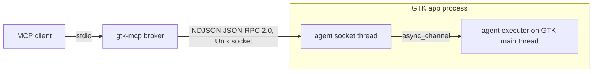

# Embedding the agent

## Shape



- Your app depends on `gtk-mcp-agent` behind a Cargo feature. Release builds
  leave the feature off.
- The only switch is at compile time: the `#[cfg]` line at the call site,
  `#[cfg(all(debug_assertions, feature = "gtk-mcp"))]` (or just the feature).
  If `attach` is called, the agent runs. If you remove `debug_assertions`
  from the line, release builds get the agent too. No environment variable
  turns it on or off.
- When the application starts up (its `startup` handler), the agent opens a
  socket at `$XDG_RUNTIME_DIR/gtk-mcp/<pid>.sock`. The directory is `0700`
  and the socket `0600`. `GTK_MCP_DIR` changes the directory. The agent
  checks each peer's user id with `SO_PEERCRED` and turns away other users.
  A second copy of a `GApplication` that only forwards to the first one
  never gets `startup`, so it never opens a socket.
- Tools that change things run whenever the agent is attached and the
  tool is listed by the broker. The handshake only reports versions
  and capabilities.
- The only environment variable the agent reads is `GTK_MCP_DIR` (the socket
  location). It doesn't remove anything from the process environment. GTK
  presets that `launch_app` sets (`GDK_DEBUG`, `GSK_RENDERER`, `LANGUAGE`,
  …) are passed on to the app's child processes.
- Every request runs on the GTK main thread through the agent's executor.
  The socket thread never touches GTK. If the main loop doesn't pick up a
  request before its deadline, the answer is `target_unresponsive` with
  `started: false`.

## Rust / Relm4: minimal integration

Cargo:

```toml
# crate Cargo.toml
[features]
gtk-mcp = ["dep:gtk-mcp-agent"]

[dependencies]
gtk-mcp-agent = { version = "0.2", optional = true }
```

The agent uses the same gtk-rs major versions as your app (`gtk4 0.11`,
`glib 0.22`). `gtk4-sys` declares `links = "gtk-4"`, so mismatched versions
fail when Cargo resolves dependencies instead of building something broken.
The agent is built against GTK 4.10 and looks up newer functions at runtime,
so it never raises the GTK version your app needs. It doesn't link
libadwaita or gtk4-layer-shell. When those are already loaded, it reaches
them through GType names, GObject properties and `dlsym`.

`main.rs`: one call on the main thread, after the application object exists:

```rust
let app = RelmApp::new(app_id.as_str()).visible_on_activate(false);

#[cfg(feature = "gtk-mcp")]
gtk_mcp_agent::attach(&relm4::main_application());

app.with_args(vec![]).run::<app::App>(init);
```

`RelmApp::new` already calls `gtk::init()`. `attach` starts the executor and
hooks into `startup`. The socket appears once the application registers, and
requests are served while the main loop runs.

With plain gtk-rs it's the same call on your own application:

```rust
let app = adw::Application::builder().application_id(APP_ID).build();
#[cfg(feature = "gtk-mcp")]
gtk_mcp_agent::attach(&app);
app.run()
```

That's all you need. Everything below is optional.

## Stable targets without a dependency

If you set a widget name, that name is its `automation_id`. Your app code
doesn't need to import the agent for this:

```rust
view! {
    gtk::Button {
        set_widget_name: "panel-clock",
        set_label: "12:00",
    }
}
```

```rust
let entry = gtk::Entry::new();
entry.set_widget_name("server-address");
```

The agent can then target `{"automation_id": "panel-clock"}` whatever the
label says and whatever language the app is in. Widget names are also CSS
IDs (`#panel-clock`).

The same name can appear once in each window. glimpse, for example, runs one
panel per monitor. Add a window selector to pick one:
`{"window": {"monitor": "DP-1"}, "automation_id": "panel-clock"}`.

## Optional adapter API

| Function | Purpose |
|---|---|
| `register_state(name, Fn() -> serde_json::Value)` | Share app state as a read-only MCP resource. The closure runs on the main thread |
| `register_settings(&settings)` | Tell the GSettings tools which `gio::Settings` object the app uses |
| `mark_secret(&widget)` | Add a widget (and its children, delegate and buffers) to the secret set |
| `register_action_group(&widget, prefix, &group)` | Make groups added with `insert_action_group` show up in lists |
| `forward_log(level, fields)` | Pass records from the app's own GLib log writer on to `read_logs` |

They all do nothing when the agent isn't active. Put the calls in one module
in your app, so the rest of the code never needs a `cfg`:

```rust
// src/mcp.rs
use gtk::{gio, glib, prelude::*};

#[cfg(feature = "gtk-mcp")]
pub use gtk_mcp_agent::{forward_log, mark_secret, register_action_group, register_state};

#[cfg(not(feature = "gtk-mcp"))]
pub fn register_state<F: Fn() -> serde_json::Value + 'static>(_name: &str, _read: F) {}

#[cfg(not(feature = "gtk-mcp"))]
pub fn mark_secret(_widget: &impl IsA<gtk::Widget>) {}

#[cfg(not(feature = "gtk-mcp"))]
pub fn register_action_group(
    _widget: &impl IsA<gtk::Widget>,
    _prefix: &str,
    _group: &impl IsA<gio::ActionGroup>,
) {
}

#[cfg(not(feature = "gtk-mcp"))]
pub fn forward_log(_level: glib::LogLevel, _fields: &[glib::LogField<'_>]) {}
```

### App state as MCP resources

The closure can borrow `Rc` state. Your app decides what the JSON looks like
and what to leave out.

```rust
let panels = Rc::clone(&self.panels);
crate::mcp::register_state("app-state/panels", move || {
    let panels = panels.borrow();
    serde_json::json!({
        "count": panels.len(),
        "outputs": panels.iter().map(|p| p.output_name()).collect::<Vec<_>>(),
    })
});
```

Registering the same name again replaces the old closure. This is also how
to share session-lock state, since gtk4-session-lock has no getters the agent
could call.

The broker always offers these resources. Each entry becomes the MCP resource `gtk-mcp://<session>/app-state/<name>`
(JSON, for example `gtk-mcp://s1/app-state/panels`), which you read with
`resources/read`.

### Secrets

The agent finds these on its own (`plan.md` 4.4):

- `GtkPasswordEntry`;
- `GtkEntry` / `GtkText` with `input-purpose` `password` or `pin`, or with
  `visibility=false` when the agent first sees it;
- `AdwPasswordEntryRow`.

This covers the widget's children, its editable delegate and its buffer. It
stays in force while the eye icon shows the text. Mark anything else
sensitive yourself:

```rust
crate::mcp::mark_secret(&token_label);
```

A capture of a password field that is hiding its text shows GTK's bullets.
Captures and render-node dumps of a field that is showing its text are
refused. Captures can still contain other sensitive pixels you didn't mark,
so don't run the agent while real credentials are on screen.

### Widget-scoped action groups

Public GTK API can't list groups added with `insert_action_group`. Register
them so the agent can:

```rust
widget.insert_action_group("panel", Some(&group));
crate::mcp::register_action_group(&widget, "panel", &group);
```

Groups you don't register can still be activated by name. `list_actions`
then reports the scope as `complete: false`.

### Logs

The agent never installs a GLib log writer. Libraries must not, and
installing a second one aborts the program. Logs come from two places:

- stderr of apps the broker launched (GTK's default structured writer prints
  there), which the broker captures;
- apps that install their own writer and call `forward_log` from it.

Otherwise `read_logs` reports `unavailable`.

```rust
// In the app's own writer (installed once, by the app, never by the agent):
glib::log_set_writer_func(|level, fields| {
    crate::mcp::forward_log(level, fields); // thread-safe; no-op when the agent is inactive
    glib::log_writer_default(level, fields)
});
```

A forwarded record looks like `{level, domain, message, fields}`.
`GLIB_DOMAIN` and `MESSAGE` are pulled out, other text fields stay in
`fields`, and binary fields are skipped. Records forwarded before a broker
connects are kept (up to 512) and sent at the handshake. `forward_log` is
Rust only; the C library has no wrapper for it.

## What `attach` does

```rust
pub fn attach(app: &impl IsA<gtk::Application>) {
    let Some(config) = Config::from_env() else { return }; // GTK_MCP_DIR or $XDG_RUNTIME_DIR/gtk-mcp
    ensure_gtk_rs_initialized();          // gtk_is_initialized() via FFI, then gtk::set_initialized()

    let (tx, rx) = async_channel::unbounded::<Incoming>();
    let agent = Agent::new(app.upcast_ref(), config);
    AGENT.with(|cell| cell.replace(Some(agent.clone())));

    // Executor: lives on the main context; runs only while the main loop iterates.
    glib::spawn_future_local(async move {
        while let Ok(incoming) = rx.recv().await {
            match incoming {
                Incoming::Request(req) => {
                    if req.cancelled() || req.past_deadline() {
                        req.reply_err(ErrorCode::NotStarted);
                        continue;
                    }
                    req.mark_started();
                    glib::spawn_future_local(agent.clone().handle(req)); // async handlers
                }
                Incoming::Cancel(id) => agent.cancel(id),
            }
        }
    });

    let app = app.upcast_ref::<gtk::Application>().clone();
    let bind = move || start_socket_thread(tx.clone()); // dir 0700, socket 0600, SO_PEERCRED
    if app.is_registered() {
        bind();
    } else {
        app.connect_startup(move |_| bind());
    }

    app.connect_shutdown(|_| {
        AGENT.with(|a| a.borrow().as_ref().map(Agent::cleanup)); // CSS, watches, highlight, socket file
    });
}
```

The socket thread reads messages, passes requests and cancels into the
channel, and writes out the responses and notifications the executor
produces. Only `Send` data, which is safe to move between threads, crosses
over: JSON and encoded PNG bytes. GTK objects and refs stay in the registry
on the main thread.

## glimpse

glimpse is a desktop shell built with GTK, and the main app this project was
made for.

- Each glimpse process (panel, lock, wallpaper, notifications, …) attaches
  on its own and shows up as its own session, told apart by app ID.
- `list_windows` shows the layer-shell settings, because gtk4-layer-shell is
  already loaded in these processes. Session-lock state comes only from
  `register_state`.
- glimpse-lock: its password field is a `GtkPasswordEntry` with the eye icon.
  The agent treats it as secret and refuses captures while it shows its text.
  If you don't want the agent changing things in the lock screen, leave it
  out of lock builds at compile time.
- glimpse runs under systemd. The agent is in or out at build time (Cargo
  feature plus the `#[cfg]` line), so you don't need a systemd drop-in for
  environment variables. `restart_app` and `stop_app` refuse these
  processes because the broker didn't launch them.

## Other languages

`gtk-mcp-agent-capi` builds a C library with a header and a GObject
Introspection typelib, so C, Python and GJS apps can use it. `attach` tells
gtk-rs that GTK is already initialized, since the host app did that.

```c
#include <gtk-mcp-agent.h>
gtk_mcp_agent_attach (GTK_APPLICATION (app));
```

```python
from gi.repository import GtkMcp
GtkMcp.attach(app)
```

```js
import GtkMcp from 'gi://GtkMcp';
GtkMcp.attach(app);
```

The compile-time switch and the socket work the same way.
