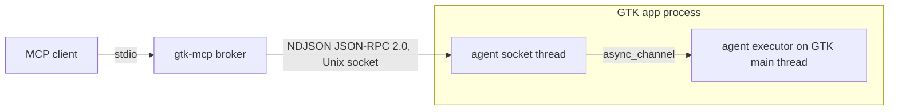

# Embedding the agent

Status: final, aligned with `plan.md` (2026-10-26).

## Shape



- The app links `gtk-mcp-agent` behind a Cargo feature that release builds do
  not enable.
- With the feature compiled in, the agent is inert unless `GTK_MCP=1` is set
  at runtime. `launch_app` sets it; for apps started elsewhere (systemd unit,
  session script) set it in a dev drop-in.
- The agent binds `$XDG_RUNTIME_DIR/gtk-mcp/<pid>.sock` (directory `0700`,
  socket `0600`; `GTK_MCP_DIR` overrides the directory) in the application's
  `startup` handler, and rejects peers whose `SO_PEERCRED` UID differs. A
  remote `GApplication` instance never emits `startup` and never binds.
- Mutations need both broker `--allow-mutations` and app
  `GTK_MCP_MUTATIONS=1`; the agent reports its side in the handshake.
- After reading `GTK_MCP*`, the agent removes those variables from its process
  environment, so apps your app launches are not instrumented. GTK presets set
  by `launch_app` (`GDK_DEBUG`, `GSK_RENDERER`, `LANGUAGE`, …) are inherited by
  them.
- Every request runs on the GTK main thread through the agent's executor; the
  socket thread never touches GTK. A main loop that doesn't pick a request up
  before its deadline yields `target_unresponsive` with `started: false`.

## Rust / Relm4: minimal integration

Cargo:

```toml
# crate Cargo.toml
[features]
gtk-mcp = ["dep:gtk-mcp-agent"]

[dependencies]
gtk-mcp-agent = { version = "0.1", optional = true }
```

The agent depends on the same gtk-rs majors as the app (`gtk4 0.11`,
`glib 0.22`). `gtk4-sys` declares `links = "gtk-4"`, so incompatible majors
fail Cargo resolution rather than building. The agent compiles against the
GTK 4.10 API floor and resolves newer symbols at runtime, so it never raises
the app's minimum GTK version. It does not link libadwaita or
gtk4-layer-shell; it reaches them through GType names, GObject properties, and
`dlsym` when they are already loaded.

`main.rs` — one call after the application object exists, on the main thread:

```rust
let app = RelmApp::new(app_id.as_str()).visible_on_activate(false);

#[cfg(feature = "gtk-mcp")]
gtk_mcp_agent::attach(&relm4::main_application());

app.with_args(vec![]).run::<app::App>(init);
```

`RelmApp::new` already calls `gtk::init()`. `attach` starts the executor and
connects to `startup`; the socket appears once the application registers, and
requests are served while the main loop runs.

Plain gtk-rs is the same call with your own application:

```rust
let app = adw::Application::builder().application_id(APP_ID).build();
#[cfg(feature = "gtk-mcp")]
gtk_mcp_agent::attach(&app);
app.run()
```

That is the entire required integration. Everything below is optional.

## Stable targets without a dependency

`automation_id` is the widget name when set explicitly. App code needs no
agent import:

```rust
view! {
    gtk::Button {
        set_widget_name: "panel-clock",
        set_label: "12:00",
    }
}
```

```rust
let entry = gtk::Entry::new();
entry.set_widget_name("server-address");
```

Agents then target `{"automation_id": "panel-clock"}` regardless of label text
or locale. Widget names are also CSS IDs (`#panel-clock`).

The same name can exist once per window (glimpse runs one panel per output).
Combine it with a window selector:
`{"window": {"monitor": "DP-1"}, "automation_id": "panel-clock"}`.

## Optional adapter API

| Function | Purpose |
|---|---|
| `register_state(name, Fn() -> serde_json::Value)` | Expose app state as a read-only MCP resource; closure runs on the main thread |
| `mark_secret(&widget)` | Add a widget (and its descendants, delegate, buffers) to the secret set |
| `register_action_group(&widget, prefix, &group)` | Make groups inserted with `insert_action_group` listable |
| `forward_log(level, fields)` | Forward records from the app's own GLib log writer to `read_logs` |

All are no-ops when the agent is inactive. Calls go through one app-local
module so the rest of the code never touches `cfg`:

```rust
// src/mcp.rs
use gtk::{gio, glib, prelude::*};

#[cfg(feature = "gtk-mcp")]
pub use gtk_mcp_agent::{forward_log, mark_secret, register_action_group, register_state};

#[cfg(not(feature = "gtk-mcp"))]
pub fn register_state<F: Fn() -> serde_json::Value + 'static>(_name: &str, _read: F) {}

#[cfg(not(feature = "gtk-mcp"))]
pub fn mark_secret(_widget: &impl IsA<gtk::Widget>) {}

#[cfg(not(feature = "gtk-mcp"))]
pub fn register_action_group(
    _widget: &impl IsA<gtk::Widget>,
    _prefix: &str,
    _group: &impl IsA<gio::ActionGroup>,
) {
}

#[cfg(not(feature = "gtk-mcp"))]
pub fn forward_log(_level: glib::LogLevel, _fields: &[glib::LogField<'_>]) {}
```

### App state as MCP resources

The closure can borrow `Rc` state. The app owns the schema and the redaction.

```rust
let panels = Rc::clone(&self.panels);
crate::mcp::register_state("app-state/panels", move || {
    let panels = panels.borrow();
    serde_json::json!({
        "count": panels.len(),
        "outputs": panels.iter().map(|p| p.output_name()).collect::<Vec<_>>(),
    })
});
```

Re-registering a name replaces the previous closure. This is also how
session-lock state is exposed: gtk4-session-lock has no getters the agent
could call.

Serving these to MCP clients is gated behind the broker's `app` toolset:
start the broker with `--toolsets core,app` (the default is `core` only).
Otherwise the broker does not advertise the resources capability and
`resources/list` returns an empty list even though the app registered state.
With the toolset on, each entry is exposed as the MCP resource
`gtk-mcp://<session>/app-state/<name>` (JSON, e.g.
`gtk-mcp://s1/app-state/panels`) and readable with `resources/read`.

### Secrets

Detected without app code (`plan.md` 4.4): `GtkPasswordEntry`;
`GtkEntry` / `GtkText` with `input-purpose` `password` or `pin`, or with
`visibility=false` when first observed; `AdwPasswordEntryRow`. Detection
covers the widget's descendants, its editable delegate, and its buffer, and
stays in force while the peek icon reveals the text. Anything else sensitive
is marked explicitly:

```rust
crate::mcp::mark_secret(&token_label);
```

Captures of non-peeking password fields show GTK's bullets; captures and
render-node dumps of a peeking field are refused. Captures still contain any
unmarked sensitive pixels; do not enable the agent on sessions with real
credentials on screen.

### Widget-scoped action groups

Groups inserted with `insert_action_group` are not enumerable through public
GTK API:

```rust
widget.insert_action_group("panel", Some(&group));
crate::mcp::register_action_group(&widget, "panel", &group);
```

Unregistered groups still activate by name; `list_actions` reports the scope
as `complete: false`.

### Logs

The agent never installs a GLib log writer (libraries must not, and a second
installation aborts). Logs come from:

- stderr of broker-launched apps (GTK's default structured writer prints
  there), captured by the broker;
- apps that install their own writer and call `forward_log` from it.

Otherwise `read_logs` reports `unavailable`.

```rust
// In the app's own writer (installed once, by the app, never by the agent):
glib::log_set_writer_func(|level, fields| {
    crate::mcp::forward_log(level, fields); // thread-safe; no-op when the agent is inactive
    glib::log_writer_default(level, fields)
});
```

The forwarded record is `{level, domain, message, fields}` (`GLIB_DOMAIN` and
`MESSAGE` are lifted out; other string fields stay in `fields`, binary fields
are skipped). Records forwarded before a broker connects are kept (512) and
delivered at the handshake. `forward_log` is a Rust API; the C ABI has no
wrapper yet.

## What `attach` does

```rust
pub fn attach(app: &impl IsA<gtk::Application>) {
    let Some(config) = Config::take_from_env() else { return }; // reads and removes GTK_MCP*
    ensure_gtk_rs_initialized();          // gtk_is_initialized() via FFI, then gtk::set_initialized()

    let (tx, rx) = async_channel::unbounded::<Incoming>();
    let agent = Agent::new(app.upcast_ref(), config);
    AGENT.with(|cell| cell.replace(Some(agent.clone())));

    // Executor: lives on the main context; runs only while the main loop iterates.
    glib::spawn_future_local(async move {
        while let Ok(incoming) = rx.recv().await {
            match incoming {
                Incoming::Request(req) => {
                    if req.cancelled() || req.past_deadline() {
                        req.reply_err(ErrorCode::NotStarted);
                        continue;
                    }
                    req.mark_started();
                    glib::spawn_future_local(agent.clone().handle(req)); // async handlers
                }
                Incoming::Cancel(id) => agent.cancel(id),
            }
        }
    });

    let app = app.upcast_ref::<gtk::Application>().clone();
    let bind = move || start_socket_thread(tx.clone()); // dir 0700, socket 0600, SO_PEERCRED
    if app.is_registered() {
        bind();
    } else {
        app.connect_startup(move |_| bind());
    }

    app.connect_shutdown(|_| {
        AGENT.with(|a| a.borrow().as_ref().map(Agent::cleanup)); // CSS, watches, highlight, socket file
    });
}
```

The socket thread parses frames, forwards requests and cancels into the
channel, and writes responses and notifications produced by the executor.
Only `Send` data crosses threads: JSON and encoded PNG bytes. Objects and refs
live in the main-thread registry.

## glimpse

- Each glimpse process (panel, lock, wallpaper, notifications, …) attaches
  separately and appears as its own session, distinguished by app ID.
- Layer-shell configuration shows in `list_windows` (gtk4-layer-shell is
  already loaded in these processes). Session-lock state comes only from
  `register_state`.
- glimpse-lock: keep `GTK_MCP_MUTATIONS` unset. Its password field is a
  `GtkPasswordEntry` with the peek icon; it is detected as secret, and captures
  are refused while it peeks.
- glimpse runs under systemd: enable the agent with a dev drop-in
  (`Environment=GTK_MCP=1`). `restart_app` / `stop_app` refuse these
  processes because the broker did not launch them.

## Other languages

`gtk-mcp-agent-capi` builds a C library with a header and a
GObject-introspection typelib. `attach` initializes gtk-rs's flag from the
host's already-initialized GTK.

```c
#include <gtk-mcp-agent.h>
gtk_mcp_agent_attach (GTK_APPLICATION (app));
```

```python
from gi.repository import GtkMcp
GtkMcp.attach(app)
```

```js
import GtkMcp from 'gi://GtkMcp';
GtkMcp.attach(app);
```

Same environment gating and socket contract.
