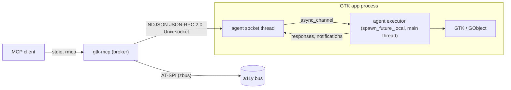

# gtk-mcp — Final Plan

Status: final, reviewed 2026-10-26. Authoritative over `tools.md`,
`widget-tree.md`, and `embedding.md` where they disagree; those documents were
updated in the same pass and must stay consistent with this one.

## 1. Goal and boundary

An MCP server that lets a coding agent inspect, exercise, render, and diagnose
a running GTK4 / libadwaita application **from inside the application
process**.

| Owned by `gtk-mcp` | Owned by `../wayland-mcp` |
|---|---|
| Widget tree, GObject properties/signals, actions, menus, shortcuts, models, layout, CSS, GTK rendering, GTK settings, GSettings, GResources, GApplication open/activate, accessibility linked to widgets | Real keyboard/pointer/touch input, desktop screenshots, OCR, window placement, compositor state, clipboard (data-control), nested compositor sandboxes |

`gtk-mcp` never injects input and never captures the desktop. When both
servers are configured, they cooperate only through the app process:
`wayland-mcp app_launch` with `GTK_MCP=1` produces a session `gtk-mcp`
discovers on its own.

## 2. Current state

- `/home/alex/projects/gtk-mcp/` contains only `docs/` (this plan,
  `tools.md`, `widget-tree.md`, `embedding.md`). No code, no git repository.
- `/home/alex/projects/wayland-mcp/` is an existing Rust MCP server (rmcp,
  stdio) whose conventions this plan reuses (section 4.1).
- Primary consumer: `/home/alex/projects/glimpse` (Rust workspace; GTK 4.22,
  libadwaita 1.9, relm4 0.11).

This plan adds: a Cargo workspace with five crates (section 6), an embedded
agent linked by glimpse binaries behind a Cargo feature, and 56 MCP tools.

## 3. Dependency discovery

### 3.1 Local code (file:line)

| Fact | Location |
|---|---|
| glimpse workspace pins `gtk4 0.11` with `v4_22`, `adw 0.9` with `v1_9`, `glib 0.22`, `relm4 0.11` | `glimpse/Cargo.toml:12,34,43,61` |
| glimpse-panel builds its app with `RelmApp::new(app_id)` then `run` | `glimpse/crates/glimpse-panel/src/main.rs:53-54` |
| `RelmApp::new` calls `crate::init()` (`gtk::init` + `adw::init`) and sets the app ID | `~/.cargo/registry/.../relm4-0.11.0/src/app.rs:33-36`, `src/lib.rs:116-120` |
| `relm4::main_application()` returns the shared `gtk::Application` | `relm4-0.11.0/src/lib.rs:131` |
| gtk-rs keeps its own initialized flag; `set_initialized` is public | `gtk4-0.11.4/src/rt.rs:20,56,67,93`; re-exported at `src/lib.rs:105` |
| rmcp tool router with annotations | `wayland-mcp/src/server.rs:374-392`, `:1401` |
| Typed params `#[derive(Deserialize, JsonSchema)]` | `wayland-mcp/src/server.rs:27-28` |
| Tool filtering, unknown names fail startup | `wayland-mcp/README.md:19-24`, `src/server.rs:376` |
| `observe` on mutating tools | `wayland-mcp/README.md:59-61`, `src/server.rs:141` |
| Batch: validated before first dispatch, ≤100 steps, no nesting, no lifecycle steps | `wayland-mcp/src/server.rs:1238-1241` |
| Lifecycle only for server-launched processes | `wayland-mcp/src/server.rs:1159,1199` |
| Bounded waits return `satisfied:false`, not an error | `wayland-mcp/src/server.rs:782` |
| GTK fixture binary behind a feature | `wayland-mcp/Cargo.toml` (`[[bin]] gtk-fixture`, `required-features = ["fixture"]`) |
| Clipboard tools already exist on the Wayland side | `wayland-mcp/src/server.rs:985,1000` |
| glimpse-lock password field is a `GtkPasswordEntry`, with peek icon | `glimpse/crates/glimpse-widgets/.../password_prompt/imp.rs:13`, `password_prompt.blp:28` (per review) |
| glimpse-panel launches child apps via `AppInfo::launch` | `glimpse/crates/glimpse-panel/src/applets/exec/mod.rs:258,301` (per review) |
| glimpse tests install their own GLib log writers | `glimpse-widgets` `calendar/tests.rs:17`, `password_prompt/tests.rs:28` (per review) |

### 3.2 Remote dependencies

`measured` = checked today against source, registry, or docs.gtk.org.
`assumed` = reasoned, not exercised; each has a spike in section 10.

| Fact | Status |
|---|---|
| `GtkAccessible` public getters: role, accessible parent/children, bounds, platform state (4.10), accessible id (4.22). No getter for name/description/states/relations | measured (docs.gtk.org method list) |
| For widgets, `gtk_accessible_get_accessible_id` returns the buildable ID | measured (gtkwidget.c, review) |
| GTK inspector modules load only when the inspector window is created | measured (`gtk/inspector/window.c:764`) |
| `GtkWidgetPaintable` paints the widget's last render node; native children (popovers) are excluded | measured (gtkwidgetpaintable.c:277-290; `gtk_widget_snapshot_child`) |
| Collapsed `GtkExpander` unparents its child and keeps a private reference | measured (gtkexpander.c:904,915) |
| Popovers are parented children of their owner widget | measured (gtkmenubutton.c:987) |
| `g_main_context_invoke` runs the closure on the caller's thread when it can acquire an unowned context | measured (glib-rs docs; gapplication.c:2704-2777) |
| GTK logs are structured; `g_log_set_writer_func` may be called once and must not be called by libraries | measured (gtk meson.build:43; gmessages.c) |
| `GObject::notify` has `G_SIGNAL_NO_HOOKS` | measured (gobject.c:1083) |
| `GDK_DEBUG=no-portals` makes `GtkFileDialog` use the in-process chooser; also disables portal OpenURI | measured (gdk.c:625; gtkfilechoosernative.c:730-735; gtkurilauncher.c:349,426) |
| gtk4-layer-shell exposes getters (`layer`, anchors, margins, exclusive zone, keyboard mode, namespace, monitor) | measured (gtk4-layer-shell 0.8 sys) |
| gtk4-session-lock exposes no configuration getters | measured (gtk4-session-lock-sys 0.4.1) |
| `AdwStyleManager` high contrast and accent are read-only; only color scheme is settable | measured |
| Also present: `gtk_shortcut_action_activate`, `gtk_widget_class_query_action`, `pango_layout_is_ellipsized`, `gtk_label_get_layout`, `g_type_get_instance_count`, `gtk_widget_child_focus`, `g_application_get_is_busy`, `gtk_widget_observe_controllers`, `gdk_frame_clock_get_timings`, `g_resources_enumerate_children`, `gtk_window_get_toplevels` | measured (review, sys crates) |
| rmcp latest stable 3.7.0 | measured (crates.io, updated 2026-10-22) |
| Synchronous AT-SPI self-call from the app main thread would deadlock | assumed → avoided by design (AT-SPI in broker) |
| A frame clock may stop ticking for hidden/occluded Wayland surfaces | assumed → spike S2 |
| GTK's accessible tree and its AT-SPI export can be joined by parallel structural walk | assumed → spike S3 |
| `GtkEventControllerLegacy` in capture phase on each toplevel observes all input events for attribution | assumed → spike S4 |

## 4. Architecture



| Component | Responsibility |
|---|---|
| `gtk-mcp` (broker) | MCP over stdio; session discovery and handshake; policy (mutations, launch, AT-SPI); toolset filtering; snapshot/capture retention; event/log/post-mortem buffers; process lifecycle for apps it launched; AT-SPI client; PNG diffing |
| `gtk-mcp-agent` | Embedded; owns the object registry, all GTK access, adapters, redaction, settle, batch execution, record |
| `gtk-mcp-protocol` | Shared serde types (section 7); the only contract between the two |
| `gtk-mcp-agent-capi` | `cdylib` + header + GIR typelib for C / Python / GJS hosts |
| `gtk-mcp-fixture` | GTK test app exercising every adapter; target of all acceptance checks |

### 4.1 Conventions reused from wayland-mcp

rmcp 3.7 with `#[tool_router]` / `#[tool(annotations(...))]`; typed params with
`schemars`; `--tools` / `--exclude-tools` with unknown names failing startup;
`observe` on mutating tools; batch validation and limits; lifecycle restricted
to server-launched processes; bounded waits returning `satisfied:false`;
fixture binary pattern; artifacts under `$XDG_DATA_HOME/gtk-mcp`.

### 4.2 Agent execution model

- `attach` must be called on the main thread after `gtk::init`. If GTK is
  initialized but gtk-rs is not (C/GI hosts), the agent checks
  `gtk_is_initialized()` through FFI and calls `gtk::set_initialized()`.
- `attach` creates an `async_channel` and starts one long-lived
  `glib::spawn_future_local` executor loop on the default main context. The
  loop runs only while the main loop iterates; requests that arrive earlier
  wait in the channel. Nothing ever calls GTK from the socket thread.
- The socket is bound in the application's `startup` handler (or immediately
  if already registered). A remote `GApplication` instance never emits
  `startup` and therefore never binds.
- Every request carries `id` and `deadline_ms`. The executor marks a request
  `started` when dequeued. Handlers are async (`wait_for`, settle, batch,
  record).
- Broker timeout → broker sends `$/cancel`. Not-yet-started requests are
  dropped and answered `not_started`. Started requests observe a cancellation
  token at their await points; if a mutation already ran, the eventual result
  is delivered as `$/late_result` and recorded in the session event log. The
  broker never retries.
- A main loop that does not dequeue within the deadline yields
  `target_unresponsive` with `started: false`.

### 4.3 Object registry

- Ref ids are stored in object qdata (`gtk-mcp-ref`); the registry maps id →
  `glib::WeakRef<glib::Object>`. Address reuse cannot resurrect an old ref.
- Widgets get `w<N>`, other GObjects `o<N>`. Actions are not objects: they are
  addressed as `{scope: Target, name}`.
- States: `live` (in a root), `detached` (alive, `gtk_widget_get_root` is NULL
  and not itself a root), `stale` (finalized).
- Operations needing a root (`interact`, `capture`, `inspect_layout`) fail
  `detached`; `inspect` / `get_property` work on detached objects.

### 4.4 Secrecy model

Secrecy is an object property, computed centrally and enforced in the value
serializer.

- Secret roots: `GtkPasswordEntry`; `GtkEntry` / `GtkText` with
  `input-purpose` `password` or `pin`; `GtkEntry` / `GtkText` with
  `visibility=false` when first observed; libadwaita `AdwPasswordEntryRow`
  (by GType name); anything passed to `mark_secret`.
- Secret set: roots, their descendants, their editable delegate
  (`gtk_editable_get_delegate`), and their buffer objects. Secrecy is sticky
  for the object's lifetime (peek toggling `visibility` does not clear it).
- Enforcement: text-bearing and length properties of secret objects return
  `{"redacted": true}`; text selectors and `wait_for` text conditions skip
  secret objects; `watch` events on secret objects carry property names only;
  `inspect_render` and `capture` refuse targets whose subtree contains a
  secret object with `visibility=true` (peeking) → `redacted`;
  `inspect_render` always replaces text nodes inside secret subtrees.
- `record` replaces secret input with placeholders `{{secret:N}}`.
- Captures of non-peeking password fields show GTK's bullets; that is accepted.

### 4.5 Policy

| Gate | Default | Set by |
|---|---|---|
| Agent active | off | `GTK_MCP=1` in the app environment |
| Mutations | off | **both** broker `--allow-mutations` and app `GTK_MCP_MUTATIONS=1`; agent reports its setting in the handshake |
| Lifecycle (`launch_app`, `restart_app`, `stop_app`) | off | broker `--allow-launch` |
| AT-SPI source | off | broker `--allow-atspi` |
| Toolsets | `core` | broker `--toolsets core,actions,...`; `--tools` / `--exclude-tools` refine |

- `launch_app` rejects caller-supplied `GTK_MCP*` variables; it sets
  `GTK_MCP_MUTATIONS` only from broker policy.
- After reading them, `attach` removes `GTK_MCP*` from its process
  environment so apps the instrumented process launches are not
  instrumented. GTK presets (`GDK_DEBUG`, `GSK_RENDERER`, `LANGUAGE`, …) are
  intentionally inherited by children; documented.
- `batch` is advertised as non-read-only; at validation it is classified from
  its steps, so read-only batches run with mutations off.

## 5. Flows

### 5.1 Discovery and handshake

```mermaid
sequenceDiagram
  participant App as App main thread
  participant Sock as Agent socket thread
  participant B as Broker
  App->>App: attach(app): read env, scrub GTK_MCP*, start executor
  App->>Sock: on startup: bind $XDG_RUNTIME_DIR/gtk-mcp/<pid>.sock (0700/0600)
  B->>B: scan dir; unlink sockets whose pid is gone
  B->>Sock: connect; SO_PEERCRED uid check
  B->>Sock: hello {protocol, broker_version}
  Sock->>App: enqueue
  App-->>Sock: hello_ack {protocol, versions, capabilities, mutations_enabled}
  Sock-->>B: hello_ack
  B->>B: protocol mismatch → session state incompatible (version_mismatch)
```

### 5.2 Request

Broker validates params, policy, and toolset → sends request with
`deadline_ms` → agent socket thread enqueues → executor dequeues (`started`),
resolves target (selector → exactly one, else `ambiguous_target` with ≤10
candidates; ref → `stale_reference` / `detached` checks) → runs handler →
applies secrecy → optional `observe` (snapshot subtree and/or settled capture)
→ response. Timeout path per 4.2.

### 5.3 Settled capture

Resolve target → `detached` / `target_unmapped` checks → if `settle` (default):
await target native's frame clock `after-paint` that occurs after the request
started, bounded by `settle_timeout_ms` (default 1000) → paintable of target →
render with the native's renderer → PNG. No paint before timeout: return the
last frame with `stale: true, reason: "no_frame"`, or `capture_unavailable`
when there has never been a frame. Animations are not awaited; callers use
`override_setting animations=false`. A window capture excludes open popovers;
popovers are captured as their own targets.

### 5.4 Batch

Validate every step before the first dispatch (tool names, params, policy,
≤100 steps, no nested `batch`, no lifecycle tools) → for each step: yield one
main-loop iteration, resolve its target at that moment (steps may use
`$N.ref` from step N's result), run with a per-step deadline → stop at the
first error unless `stop_on_error:false` → per-step results. No rollback.

### 5.5 Launch, restart, stop, post-mortem

`launch_app` (policy-gated) spawns argv without a shell, with presets and
optional `WAYLAND_DISPLAY`, capturing stdout/stderr into a cursor log → waits
for the session socket → returns session. `restart_app` / `stop_app` act only
on broker-launched processes (process group, SIGTERM then SIGKILL). On socket
EOF or process exit, the session becomes `exited` with code/signal, the
in-flight request id, and the retained logs/events; it stays listed until the
broker drops it (bounded count).

### 5.6 Record

`record` installs: a capture-phase `GtkEventControllerLegacy` on every
toplevel (timestamps the last real input event), and emission hooks on
`GtkButton::clicked`, `GtkToggleButton::toggled`, `GtkCheckButton::toggled`,
`GtkSwitch::state-set`, `GtkEditable::changed`, `GtkExpander::activate`,
`GtkRange::value-changed`, `GtkSpinButton::value-changed`,
`GSimpleAction::activate`, `GSimpleAction::change-state`. Emissions during the
agent's own handlers are ignored (reentrancy flag). Emissions within 300 ms of
a real input event are `human`; others `app`. `stop_recording` emits a `batch`
script using selectors (automation_id > buildable_id > type + text + ancestor),
with secret values as `{{secret:N}}` placeholders, and lists `app` emissions
separately.

## 6. Repository layout

```text
gtk-mcp/
  Cargo.toml                       # workspace
  crates/gtk-mcp-protocol/         # serde types, PROTOCOL_VERSION
  crates/gtk-mcp-agent/            # rlib; deps: gtk4 (v4_10 floor), glib, gio, async-channel, serde_json
  crates/gtk-mcp-agent-capi/       # cdylib, gtk-mcp-agent.h, GtkMcp-1.gir/typelib
  crates/gtk-mcp/                  # broker bin; deps: rmcp 3.7, tokio, schemars 1, zbus 5, image
  crates/gtk-mcp-fixture/          # GTK + libadwaita test app
  docs/
```

- The agent compiles against the gtk4 `v4_10` floor. Newer symbols
  (`gtk_accessible_get_accessible_id`, 4.22) and libadwaita functions are
  resolved with `dlsym`; libadwaita objects are handled by GType name and
  GObject properties. The agent never links libadwaita or gtk4-layer-shell.
- gtk4-layer-shell getters are resolved with `dlsym(RTLD_DEFAULT)` only when
  the library is already loaded.
- `gtk4-sys` declares `links = "gtk-4"`, so an app and agent on incompatible
  gtk4 crate majors fail Cargo resolution; the agent's supported range tracks
  glimpse (`gtk4 0.11`).

## 7. Contract types

```rust
// gtk-mcp-protocol

pub const PROTOCOL_VERSION: u32 = 1;
pub const MAX_FRAME_BYTES: usize = 32 * 1024 * 1024; // PNGs travel base64 inside JSON

// Framing: one JSON-RPC 2.0 message per line (NDJSON). Many requests in flight.
// Broker → agent methods: "hello", tool names (e.g. "snapshot"), "$/cancel".
// Agent → broker notifications: "$/event", "$/log", "$/progress", "$/late_result".

#[derive(Serialize, Deserialize, JsonSchema)]
pub struct Hello { pub protocol: u32, pub broker_version: String }

#[derive(Serialize, Deserialize, JsonSchema)]
pub struct HelloAck {
    pub protocol: u32,
    pub agent_version: String,
    pub pid: u32,
    pub app_id: Option<String>,
    pub gtk_version: [u32; 3],
    pub adw_version: Option<[u32; 3]>,
    pub capabilities: Vec<Capability>,
    pub mutations_enabled: bool,
}

#[derive(Serialize, Deserialize, JsonSchema)]
#[serde(rename_all = "snake_case")]
pub enum Capability { Adwaita, LayerShell, AccessibleId, LogForwarding, InstanceCount }

#[derive(Serialize, Deserialize, JsonSchema)]
pub struct RequestMeta { pub deadline_ms: u64 } // carried in params._meta

#[derive(Serialize, Deserialize, JsonSchema)]
pub struct Cancel { pub id: u64 }

#[derive(Serialize, Deserialize, JsonSchema)]
pub struct LateResult { pub id: u64, pub result: serde_json::Value }

#[derive(Serialize, Deserialize, JsonSchema, Clone, Copy, PartialEq, Eq)]
#[serde(rename_all = "snake_case")]
pub enum ErrorCode {
    InvalidParams,
    NotFound,
    AmbiguousTarget,
    StaleReference,
    Detached,
    TargetUnmapped,
    UnsupportedOperation,
    InvalidValue,
    MutationsDisabled,
    LaunchDisabled,
    Redacted,
    Timeout,
    NotStarted,
    TargetUnresponsive,
    CaptureUnavailable,
    SnapshotUnavailable,
    SessionExited,
    VersionMismatch,
    AgentInactive,
    Unavailable, // feature needs a preset/diagnostic that is off (e.g. instance counts)
}

#[derive(Serialize, Deserialize, JsonSchema)]
pub struct AgentError { pub code: ErrorCode, pub message: String, pub data: Option<serde_json::Value> }

// Targets: a ref string ("w12", "o4") or a selector object.
#[derive(Serialize, Deserialize, JsonSchema)]
#[serde(untagged)]
pub enum Target { Ref(String), Select(Selector) }

#[derive(Serialize, Deserialize, JsonSchema, Default)]
pub struct Selector {
    pub window: Option<WindowSel>,
    pub automation_id: Option<String>,
    pub buildable_id: Option<String>,
    pub type_name: Option<String>,      // matches the GType or any ancestor type
    pub css_class: Option<String>,
    pub text: Option<String>,           // exact; never matches secret objects
    pub text_contains: Option<String>,  // never matches secret objects
    pub role: Option<String>,
    pub state: Option<StateFilter>,
    pub ancestor: Option<Box<Selector>>,
    pub include_detached: Option<bool>, // default false
    pub nth: Option<usize>,             // disambiguate in tree order
}
// All present keys must match (AND). Single-target tools require exactly one
// match after `nth`; otherwise AmbiguousTarget with up to 10 candidates.

#[derive(Serialize, Deserialize, JsonSchema)]
#[serde(rename_all = "snake_case")]
pub enum WindowSel {
    Ref(String),
    Title(String),
    Monitor(String),        // GdkMonitor connector, e.g. "DP-1" (one glimpse panel per output)
    AppWindowId(u32),       // gtk_application_window_get_id
    LayerNamespace(String), // when layer shell is loaded
}

#[derive(Serialize, Deserialize, JsonSchema, Default)]
pub struct StateFilter {
    pub visible: Option<bool>, pub mapped: Option<bool>, pub sensitive: Option<bool>,
    pub has_focus: Option<bool>, pub expanded: Option<bool>, pub active: Option<bool>,
    pub checked: Option<bool>, pub selected: Option<bool>,
}

#[derive(Serialize, Deserialize, JsonSchema)]
#[serde(tag = "operation", rename_all = "snake_case")]
pub enum InteractOp {
    Activate, Focus,
    Fill { text: String },
    SetChecked { checked: bool },
    SetActive { active: bool },
    SetValue { value: f64 },
    SetExpanded { expanded: bool },
    Select { index: u32 },
    SelectPage { name: String },
    Popup, Popdown,
    ScrollTo,
    ScrollBy { dx: f64, dy: f64 },
    Close,
    Play, Pause,
    Seek { microseconds: i64 },
}

#[derive(Serialize, Deserialize, JsonSchema, Default)]
pub struct Observe {
    pub snapshot_depth: Option<u32>, // snapshot of the target subtree after the action
    pub capture: Option<bool>,       // settled capture of the target after the action
}

#[derive(Serialize, Deserialize, JsonSchema)]
pub struct InteractParams {
    pub session: String,
    pub target: Target,
    #[serde(flatten)]
    pub op: InteractOp,
    pub observe: Option<Observe>,
}

#[derive(Serialize, Deserialize, JsonSchema)]
pub struct InteractResult {
    pub target: String,              // resolved ref
    pub observed: serde_json::Value, // state read back after the operation
    pub observation: Option<serde_json::Value>,
    pub observation_error: Option<AgentError>, // dispatch succeeded, observation failed
}

#[derive(Serialize, Deserialize, JsonSchema)]
pub struct BatchStep { pub tool: String, pub arguments: serde_json::Value } // "$N.ref" allowed in targets

#[derive(Serialize, Deserialize, JsonSchema)]
pub struct BatchParams { pub session: String, pub steps: Vec<BatchStep>, pub stop_on_error: Option<bool> }

#[derive(Serialize, Deserialize, JsonSchema)]
pub struct CaptureParams {
    pub session: String,
    pub target: Target,
    pub settle: Option<bool>,            // default true
    pub settle_timeout_ms: Option<u64>,  // default 1000
    pub annotate: Option<bool>,          // overlay refs of visible descendants
    pub scale: Option<f64>,
}

#[derive(Serialize, Deserialize, JsonSchema)]
pub struct CaptureResult {
    pub capture_id: String,
    pub target: String,
    pub width: u32, pub height: u32, pub scale: f64,
    pub stale: bool,
    pub stale_reason: Option<String>,
    pub annotations: Vec<Annotation>,
}

#[derive(Serialize, Deserialize, JsonSchema)]
pub struct Annotation { pub r#ref: String, pub x: f64, pub y: f64, pub width: f64, pub height: f64 }

#[derive(Serialize, Deserialize, JsonSchema)]
#[serde(rename_all = "snake_case")]
pub enum SessionState { Running, Incompatible, Exited { code: Option<i32>, signal: Option<i32>, in_flight: Option<u64> } }

#[derive(Serialize, Deserialize, JsonSchema)]
pub struct SessionInfo {
    pub session: String,
    pub pid: u32,
    pub app_id: Option<String>,
    pub launched_by_broker: bool,
    pub state: SessionState,
    pub hello: Option<HelloAck>,
}
```

Snapshot node shape: `widget-tree.md` ("Canonical JSON form"), unchanged by
this section.

### 7.1 Configuration

| Name | Where | Meaning |
|---|---|---|
| `GTK_MCP=1` | app env | activate the agent |
| `GTK_MCP_MUTATIONS=1` | app env | agent accepts mutations (broker policy also required) |
| `GTK_MCP_DIR` | app env and broker | socket directory override; default `$XDG_RUNTIME_DIR/gtk-mcp` |
| `--toolsets`, `--tools`, `--exclude-tools` | broker | tool exposure; unknown names fail startup |
| `--allow-mutations`, `--allow-launch`, `--allow-atspi` | broker | policy gates |
| `--retain-snapshots N` (16), `--retain-captures N` (16), `--retain-exited N` (8) | broker | bounded retention |

Socket path: `<dir>/<pid>.sock` (short enough for `sun_path`); app ID and
versions travel in the handshake.

## 8. How the pieces connect

- MCP tool params (`InteractParams`, `CaptureParams`, …) are defined once in
  `gtk-mcp-protocol`; the broker derives rmcp schemas from them and forwards
  the same JSON as the JSON-RPC `params` with `_meta.deadline_ms`.
- The broker resolves `session` to a socket connection; the agent resolves
  `Target` against its registry (4.3) and applies the secrecy model (4.4)
  before serializing any value.
- Snapshots and captures are produced by the agent and retained by the
  broker (`snapshot_id`, `capture_id`), which serves `diff_snapshots` and
  `diff_captures` without calling the agent.
- `$/event`, `$/log`, `$/progress`, `$/late_result` notifications feed broker
  ring buffers that back `read_events`, `read_logs`, MCP progress, and
  post-mortems.
- AT-SPI data is fetched by the broker and joined to agent refs through the
  agent's `accessible_tree` (structural walk, spike S3); unjoined AT-SPI nodes
  are returned with `ref: null`.
- Logs: broker captures stderr of broker-launched apps (GTK's default
  structured writer prints there). Apps that install their own writer can call
  `gtk_mcp_agent::forward_log(level, fields)` from it (`LogForwarding`
  capability). The agent never installs a writer.

## 9. Acceptance criteria

All checks run against `gtk-mcp-fixture` unless stated.

```text
AC-1  As an agent, I want to discover instrumented apps, so that I can target the right process.
      GIVEN the fixture runs with GTK_MCP=1 WHEN list_apps THEN it appears Running with versions and capabilities.
      GIVEN a stale socket from a killed process WHEN list_apps THEN it is not listed and the socket is removed.
      Verify by: broker integration test discovery_*.

AC-2  As an agent, I want a widget tree with stable refs, so that I can choose targets.
      GIVEN a window WHEN snapshot twice THEN the same live widgets carry the same refs and text/JSON describe the same hierarchy.
      GIVEN a collapsed GtkExpander WHEN snapshot THEN its child appears with attached=false, via "GtkExpander:child".
      Verify by: fixture test snapshot_*.

AC-3  As an agent, I want precise errors for bad targets, so that I never act on the wrong widget.
      GIVEN two buttons with text "Save" WHEN interact target={text:"Save"} THEN ambiguous_target with both candidates.
      GIVEN a widget removed from its parent but alive WHEN interact THEN detached; WHEN it is finalized THEN stale_reference.
      Verify by: fixture test targets_*.

AC-4  As an agent, I want semantic interaction with readback, so that I know the resulting state.
      GIVEN mutations enabled WHEN interact set_expanded=true THEN observed {"expanded":true}; repeating it also succeeds.
      GIVEN mutations disabled in broker or agent WHEN interact THEN mutations_disabled and no change.
      Verify by: fixture test interact_*.

AC-5  As an agent, I want settled widget captures, so that images reflect the state I just set.
      GIVEN set_expanded then capture WHEN the frame paints THEN the PNG shows the expanded content and stale=false.
      GIVEN an unmapped target WHEN capture THEN target_unmapped.
      Verify by: fixture test capture_* (pixel comparison against an expected region).

AC-6  As a user, I want secrets never exposed, so that debugging does not leak credentials.
      GIVEN a GtkPasswordEntry with text WHEN snapshot, get_property on it/its GtkText/its buffer, query text, watch notify::text, inspect_render THEN no content or length is returned.
      GIVEN the peek icon active WHEN capture THEN redacted.
      Verify by: fixture test secrets_* (asserts the secret string is absent from every response byte).

AC-7  As an agent, I want actions discoverable and invocable, so that I can exercise commands directly.
      GIVEN win.save registered WHEN list_actions + activate_action THEN the fixture's handler runs once.
      GIVEN a stateful action WHEN change_action_state THEN observed state is returned, including when the app rejects the change.
      Verify by: fixture test actions_*.

AC-8  As an agent, I want a non-blocking agent, so that a stuck app cannot hang my session.
      GIVEN the fixture blocks its main loop 5 s WHEN snapshot with a 1 s deadline THEN target_unresponsive started=false, and nothing executes after unblocking.
      GIVEN a started mutation that outlives its deadline THEN $/late_result is recorded in read_events.
      Verify by: fixture test dispatch_*.

AC-9  As an agent, I want batches, so that I can do multi-step flows in one call.
      GIVEN steps [interact, wait_for, capture using $1.ref] WHEN batch THEN per-step results and a settled capture.
      GIVEN an invalid third step WHEN batch THEN nothing executes.
      GIVEN only read-only steps with mutations off WHEN batch THEN it runs.
      Verify by: fixture test batch_*.

AC-10 As a developer, I want live CSS iteration, so that I can style without rebuilding.
      GIVEN invalid CSS WHEN apply_css THEN diagnostics with line/column and no provider installed.
      GIVEN valid CSS WHEN apply_css, capture, remove_css THEN the change appears and is reverted; client disconnect also reverts.
      Verify by: fixture test css_*.

AC-11 As an agent, I want app lifecycle under broker control, so that rebuild loops are one call.
      GIVEN --allow-launch WHEN launch_app THEN a session appears; WHEN the app panics THEN the session is Exited with signal, in-flight id, and last logs.
      GIVEN a process not launched by the broker WHEN restart_app or stop_app THEN refused.
      GIVEN launch_app env containing GTK_MCP_MUTATIONS THEN invalid_params.
      Verify by: broker integration test lifecycle_*.

AC-12 As an agent, I want layout evidence, so that I can explain sizing bugs.
      GIVEN an ellipsized GtkLabel WHEN audit_layout THEN a finding with its ref; WHEN inspect_layout for_size=360 THEN measured min/natural for that width.
      Verify by: fixture test layout_*.

AC-13 As an agent, I want accessibility data linked to widgets, so that I can fix a11y bugs in code.
      GIVEN --allow-atspi WHEN inspect_accessible on a button THEN GTK fields plus AT-SPI name, each tagged with its source.
      GIVEN --allow-atspi off THEN AT-SPI fields are reported unavailable and AT-SPI-dependent audit rules as skipped.
      Verify by: fixture test a11y_* (runs with a private a11y bus).

AC-14 As a developer, I want recordings turned into replayable scripts, so that manual repros become tests.
      GIVEN record, a human types into an entry and clicks a button, stop_recording THEN a batch script with selectors; replaying it in a new session reproduces the state.
      Verify by: fixture test record_* driven by wayland-mcp real input in a sandbox (live check).

AC-15 As the glimpse developer, I want to inspect my shell, so that I can debug panels and lock screen.
      GIVEN glimpse-panel built with feature gtk-mcp and GTK_MCP=1 WHEN list_windows THEN one window per output with layer-shell data, selectable by WindowSel::Monitor.
      GIVEN glimpse-lock without GTK_MCP_MUTATIONS WHEN interact THEN mutations_disabled; WHEN snapshot THEN the password field is redacted.
      Verify by: live check on the niri host.
```

## 10. Milestones

| Milestone | Delivers | Exit |
|---|---|---|
| M0 Foundation | workspace, protocol crate, agent attach/executor/registry/secrecy core, broker discovery/handshake/policy/toolsets, fixture; `list_apps`, `list_windows`, `snapshot`, `query`, `inspect` | AC-1, AC-2, AC-3 (stale/detached parts), AC-8 |
| M1 Interaction | `list_properties`, `get_property`, `set_property`, `list_signals`, `interact` + adapters, `inspect_text`, `edit_text`, `wait_for`, `batch`, `inspect_model`, `capture`, `diff_snapshots`, `diff_captures`, `observe` | AC-3, AC-4, AC-5, AC-6, AC-9 |
| M2 Actions | actions toolset | AC-7 |
| M3 Layout and style | layout-style toolset | AC-10, AC-12 |
| M4 Lifecycle and app | `launch_app`, `restart_app`, `stop_app`, post-mortems, app toolset, `object_stats` | AC-11 |
| M5 Diagnostics | `watch`, `read_events`, `unwatch`, `read_logs`, `measure_frames`, `record`, `stop_recording` | AC-14 |
| M6 Accessibility | broker AT-SPI, join, a11y toolset | AC-13 |
| M7 Other languages | `gtk-mcp-agent-capi`, header, GIR, Python/GJS smoke | attach + snapshot from Python and GJS fixtures |
| M8 glimpse | `gtk-mcp` feature in glimpse binaries, systemd dev drop-in, `register_state` for panels and lock state | AC-15 |

Spikes, each before its milestone:

| Spike | Question | Before |
|---|---|---|
| S1 | Executor + channel delivers requests before and after `run` in relm4 apps, including relm4's post-run iteration | M0 |
| S2 | `after-paint` behavior for hidden/occluded surfaces on niri; define `no_frame` handling | M1 |
| S3 | Structural join between GTK accessible tree and AT-SPI export | M6 |
| S4 | Legacy controller attribution of human input vs app emissions | M5 |

## 11. Struck / rejected

| Item | Reason |
|---|---|
| `clipboard_read` / `clipboard_write` | Review M10: Wayland delivers selection offers with keyboard focus; layer-shell panels see stale data; writes need an input serial. `wayland-mcp` already provides data-control clipboard tools (`server.rs:985,1000`). Changes the previously accepted list. |
| Session-lock configuration in `list_windows` | No getters in gtk4-session-lock; app state via `register_state` instead |
| Agent-installed GLib log writer | Libraries must not install one; second install aborts |
| `LD_PRELOAD` injection, GTK inspector-module bootstrap | Unreliable startup; inspector modules load only with the inspector window |
| Linking libadwaita / gtk4-layer-shell into the agent | Forces dependencies onto apps; layer-shell shim load-order constraints. dlsym + GType names instead |
| Popovers as separate snapshot roots | They are parented children; duplicate refs |
| Row widget ↔ model item mapping in `inspect_model` | Private list item wrapper; adapter-only |
| Widget-class action enabled state | No public getter; reported `null` |
| Computed CSS and style provenance | Not public API |
| Synthesized input, desktop capture, window placement | `wayland-mcp` |
| Arbitrary evaluation, method calls, signal emission | Unsafe; typed operations instead |
| Agent-side AT-SPI client | Self-call deadlock risk; broker owns AT-SPI |
| `restart_app` for externally started apps (systemd) | Double-spawn; killing a locker leaves the session locked |
| `identity.accessible_id` node field | Equals the buildable ID for widgets |

## 12. Open questions (all closed)

1. ~~Embedded or external?~~ Embedded agent + external broker.
2. ~~Injection method?~~ Explicit `attach`, Cargo feature, runtime `GTK_MCP=1`.
3. ~~Launch apps?~~ Yes, broker-launched only, behind `--allow-launch`.
4. ~~File dialogs?~~ `GDK_DEBUG=no-portals` preset; portal dialogs unsupported.
5. ~~GSettings / GApplication open?~~ In scope (app toolset).
6. ~~Dispatch model?~~ Main-thread executor fed by a channel (4.2).
7. ~~Collapsed expander content?~~ Detached-content adapters (`attached: false`).
8. ~~Mutation gate?~~ Broker flag AND agent env; handshake reports the agent side.
9. ~~Logs?~~ Broker stderr capture + opt-in `forward_log`.
10. ~~Clipboard?~~ Struck; `wayland-mcp`.
11. ~~Selector collisions across glimpse panels?~~ `WindowSel::Monitor` and `nth`.
12. ~~Toolset exposure?~~ Broker `--toolsets`, default `core`.
13. ~~Wire framing and images?~~ NDJSON JSON-RPC 2.0, base64 PNG, 32 MiB frame cap.
14. ~~Version skew?~~ `PROTOCOL_VERSION` in handshake; mismatch → `Incompatible` session.

## 13. Review record

Reviewer: `GtkMcpDocReview` (independent reviewer agent), 2026-10-26, over
`tools.md`, `widget-tree.md`, `embedding.md`.

| Finding | Resolution |
|---|---|
| B1 dispatch runs off-thread before `run`; no async; late mutations | 4.2 executor model, `not_started`, `$/late_result` |
| B2 collapsed expander child not in tree | detached-content adapters; AC-2 |
| B3 no wire protocol, errors, selectors | sections 7, 7.1 |
| M1 log writer | 8 (stderr + `forward_log`); struck agent writer |
| M2 secret leaks (buffers, peek, selectors, watch, render, clipboard) | 4.4; AC-6; clipboard struck |
| M3 session-lock getters absent; layer-shell linking | struck; dlsym (6) |
| M4 mutation gate inconsistent/bypassable; env inheritance; batch | 4.5 |
| M5 popovers duplicated; captures exclude them | `widget-tree.md` in-place natives; 5.3 |
| M6 AT-SPI placement and join | broker-side; spike S3 |
| M7 settle undefined | 5.3 |
| M8 record mechanism | 5.6; spike S4 |
| M9 batch semantics | 5.4 |
| M10 clipboard on Wayland | struck |
| M11 `inspect_model` vs exclusion | adapter-only mapping |
| M12 C/GI init panic; libadwaita linking | 4.2, 6 |
| M13 restart of external apps | broker-launched only |
| M14 toolset mechanism | 4.5, 7.1 |
| M15 detached vs stale | 4.3 |
| Minors (full-view wording, accessible_id, socket path/bind time, class-action enabled, ellipsis scope, highlight class, focus walk side effects, diff ids, action refs, no-portals scope, instance count availability, example, glimpse-lock type, visibility scope, shortcut scopes) | applied across `tools.md`, `widget-tree.md`, `embedding.md`, and sections 4–7, 11 |

Self-consistency pass (this plan): every type named in prose appears in
section 7; every enum variant in section 7 is used by a flow, tool, or AC.
Tool totals verified against `tools.md`: 56 tools, 17 mutating.

## 14. Durability

`gtk-mcp/` is not yet a git repository. Before slicing into issues: initialize
the repository, commit `docs/`, and create beads issues per milestone with
`Source:` lines pointing at sections of this plan.
