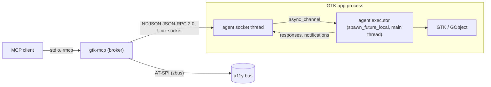

# gtk-mcp: final plan

Status: final, reviewed 2026-10-26. If this plan and `tools.md`,
`widget-tree.md` or `embedding.md` disagree, this plan wins. Those documents
were updated in the same pass and must stay consistent with it.

## 1. Goal and boundary

gtk-mcp is an MCP server. It lets a coding agent inspect, use, render and
diagnose a running GTK4 / libadwaita app **from inside the app's process**.

| Owned by `gtk-mcp` | Owned by `../wayland-mcp` |
|---|---|
| Widget tree, GObject properties/signals, actions, menus, shortcuts, models, layout, CSS, GTK rendering, GTK settings, GSettings, GResources, GApplication open/activate, accessibility linked to widgets | Real keyboard/pointer/touch input, desktop screenshots, OCR, window placement, compositor state, clipboard (data-control), nested compositor sandboxes |

`gtk-mcp` never fakes input and never captures the desktop. When both
servers are set up, they only meet through the app process: if
`wayland-mcp app_launch` starts an app with the agent compiled in, `gtk-mcp`
finds that session by itself.

## 2. Current state

When this plan was written:

- `/home/alex/projects/gtk-mcp/` held only `docs/` (this plan,
  `tools.md`, `widget-tree.md`, `embedding.md`). No code, no git repository.
- `/home/alex/projects/wayland-mcp/` was an existing Rust MCP server (rmcp,
  stdio). This plan reuses its conventions (section 4.1).
- The main user is `/home/alex/projects/glimpse` (Rust workspace; GTK 4.22,
  libadwaita 1.9, relm4 0.11).

The plan adds a Cargo workspace with five crates (section 6), an embedded
agent that glimpse binaries link behind a Cargo feature, and 56 MCP tools.

## 3. Dependency discovery

### 3.1 Local code (file:line)

| Fact | Location |
|---|---|
| glimpse workspace pins `gtk4 0.11` with `v4_22`, `adw 0.9` with `v1_9`, `glib 0.22`, `relm4 0.11` | `glimpse/Cargo.toml:12,34,43,61` |
| glimpse-panel builds its app with `RelmApp::new(app_id)` then `run` | `glimpse/crates/glimpse-panel/src/main.rs:53-54` |
| `RelmApp::new` calls `crate::init()` (`gtk::init` + `adw::init`) and sets the app ID | `~/.cargo/registry/.../relm4-0.11.0/src/app.rs:33-36`, `src/lib.rs:116-120` |
| `relm4::main_application()` returns the shared `gtk::Application` | `relm4-0.11.0/src/lib.rs:131` |
| gtk-rs keeps its own initialized flag; `set_initialized` is public | `gtk4-0.11.4/src/rt.rs:20,56,67,93`; re-exported at `src/lib.rs:105` |
| rmcp tool router with annotations | `wayland-mcp/src/server.rs:374-392`, `:1401` |
| Typed params `#[derive(Deserialize, JsonSchema)]` | `wayland-mcp/src/server.rs:27-28` |
| Tool filtering, unknown names fail startup | `wayland-mcp/README.md:19-24`, `src/server.rs:376` |
| `observe` on mutating tools | `wayland-mcp/README.md:59-61`, `src/server.rs:141` |
| Batch: validated before first dispatch, ≤100 steps, no nesting, no lifecycle steps | `wayland-mcp/src/server.rs:1238-1241` |
| Lifecycle only for server-launched processes | `wayland-mcp/src/server.rs:1159,1199` |
| Bounded waits return `satisfied:false`, not an error | `wayland-mcp/src/server.rs:782` |
| GTK fixture binary behind a feature | `wayland-mcp/Cargo.toml` (`[[bin]] gtk-fixture`, `required-features = ["fixture"]`) |
| Clipboard tools already exist on the Wayland side | `wayland-mcp/src/server.rs:985,1000` |
| glimpse-lock password field is a `GtkPasswordEntry`, with peek icon | `glimpse/crates/glimpse-widgets/.../password_prompt/imp.rs:13`, `password_prompt.blp:28` (per review) |
| glimpse-panel launches child apps via `AppInfo::launch` | `glimpse/crates/glimpse-panel/src/applets/exec/mod.rs:258,301` (per review) |
| glimpse tests install their own GLib log writers | `glimpse-widgets` `calendar/tests.rs:17`, `password_prompt/tests.rs:28` (per review) |

### 3.2 Remote dependencies

`measured` = checked on the review date against source, the crate registry
or docs.gtk.org. `assumed` = reasoned through but not tried; each one has a
spike (a small throwaway experiment) in section 10.

| Fact | Status |
|---|---|
| `GtkAccessible` public getters: role, accessible parent/children, bounds, platform state (4.10), accessible id (4.22). No getter for name/description/states/relations | measured (docs.gtk.org method list) |
| For widgets, `gtk_accessible_get_accessible_id` returns the buildable ID | measured (gtkwidget.c, review) |
| GTK inspector modules load only when the inspector window is created | measured (`gtk/inspector/window.c:764`) |
| `GtkWidgetPaintable` paints the widget's last render node; native children (popovers) are excluded | measured (gtkwidgetpaintable.c:277-290; `gtk_widget_snapshot_child`) |
| Collapsed `GtkExpander` unparents its child and keeps a private reference | measured (gtkexpander.c:904,915) |
| Popovers are parented children of their owner widget | measured (gtkmenubutton.c:987) |
| `g_main_context_invoke` runs the closure on the caller's thread when it can acquire an unowned context | measured (glib-rs docs; gapplication.c:2704-2777) |
| GTK logs are structured; `g_log_set_writer_func` may be called once and must not be called by libraries | measured (gtk meson.build:43; gmessages.c) |
| `GObject::notify` has `G_SIGNAL_NO_HOOKS` | measured (gobject.c:1083) |
| `GDK_DEBUG=no-portals` makes `GtkFileDialog` use the in-process chooser; also disables portal OpenURI | measured (gdk.c:625; gtkfilechoosernative.c:730-735; gtkurilauncher.c:349,426) |
| gtk4-layer-shell exposes getters (`layer`, anchors, margins, exclusive zone, keyboard mode, namespace, monitor) | measured (gtk4-layer-shell 0.8 sys) |
| gtk4-session-lock exposes no configuration getters | measured (gtk4-session-lock-sys 0.4.1) |
| `AdwStyleManager` high contrast and accent are read-only; only color scheme is settable | measured |
| Also present: `gtk_shortcut_action_activate`, `gtk_widget_class_query_action`, `pango_layout_is_ellipsized`, `gtk_label_get_layout`, `g_type_get_instance_count`, `gtk_widget_child_focus`, `g_application_get_is_busy`, `gtk_widget_observe_controllers`, `gdk_frame_clock_get_timings`, `g_resources_enumerate_children`, `gtk_window_get_toplevels` | measured (review, sys crates) |
| rmcp latest stable 3.7.0 | measured (crates.io, updated 2026-10-22) |
| Synchronous AT-SPI self-call from the app main thread would deadlock | assumed → avoided by design (AT-SPI in broker) |
| A frame clock may stop ticking for hidden/occluded Wayland surfaces | measured (spike S2, nested niri 26.04): `after-paint` after `queue_draw()` fires for visible-focused, fully covered, unfocused and off-workspace windows (6/6 within 1 s, 0.6 to 17 ms idle); an unmapped (`set_visible(false)`) window never paints (0/3). niri has no minimized state. Consecutive frames in a burst are ~0.98 s apart (frame-callback throttling), so a second capture right after a commit can miss a 1000 ms window |
| `GtkEventControllerLegacy` in capture phase on each toplevel observes input for attribution | measured (spike S4, `spikes/s4-input-attribution`, nested niri 26.04, real input from wayland-mcp virtual pointer/keyboard, 2026-10-26): the toplevel's capture controller sees `ButtonPress/Release`, `Motion`, `KeyPress/Release` for widgets inside the window. Emissions follow the last input event by 0.1 to 1.3 ms (typed text → `GtkEditable::changed`), 0.2 to 0.6 ms (button click: `clicked` fires on release, after the controller saw it) and ~100 ms (`GtkSwitch::state-set`, animated). **Popovers are separate natives**: key presses and clicks inside an open popover menu reach only a controller installed on the popover (`popover KeyPress` logged, nothing on the window), so the controller must be added to every `GtkPopover` too. **Limits of the 300 ms rule**: an app emission that happens to fall within 300 ms after real input is attributed `human` (seen once: an app timer 230 ms after a switch click); the window is a rule of thumb. Driving note: a long-lived wayland-mcp server delivered only its first virtual-pointer click in the nested niri (output `Flipped180`, 1433×1745); a fresh server per click delivered all of them; key input was unaffected |
| GTK's accessible tree and its AT-SPI export can be joined by parallel structural walk | measured (spike S3, GTK 4.2x + libadwaita 0.9 fixture, private session + a11y bus, 2026-10-26): an order-preserving alignment per sibling list (role-compatibility score, +buildable id/`AccessibleId`, +label = name) joins 300 of 304 AT-SPI nodes (99 %; the 3 unjoined are `GtkDropDown` list-item wrappers, `ref: null`). Only 29 % of the 1034 `GtkAccessible` nodes are exported (734 are not: role `none`/`presentation` internals such as the `GtkText` inside entries, list-view row wrappers, unrealized/hidden content), so join success is measured against the AT-SPI side. Every named control in the fixture (`automation_id`) joins except `AdwSpinRow` internals. 50 of 300 pairs also match by `AccessibleId` = buildable id; widgets without buildable ids (plain gtk-rs/relm4 widgets) join by structure alone. GTK's own `GetRoleName` returns the `GtkAccessibleRole` nick with spaces (`text box`, `list item`), which is the strong role signal (the AT-SPI role enum names do not appear) |
| A private session bus activates `org.a11y.Bus` but not the AT-SPI registry | measured (S3): without systemd/gnome-session nobody starts `at-spi2-registryd`; `Registry` calls fail with "Could not activate remote peer ... unit failed". The test harness starts one on the private bus (own `XDG_RUNTIME_DIR`, so `at-spi/bus_N` cannot collide with the user's a11y bus). AT-SPI method calls and signal streams must use separate connections: a signal stream's bounded queue applies backpressure to its connection and stalled every reply (4 s timeouts) until the event source got its own |
| An app is found on the a11y bus by `GetConnectionUnixProcessID` of the registry's application roots | measured (S3) |
| A `glib::spawn_future_local` executor fed by an `async_channel` from a plain thread delivers requests queued before `RelmApp::run` (served once the loop starts, ~7 ms after the send in the spike), during `run`, and none are handled on the sending thread (every handler observed `on_main=true`) | measured (spike S1, `spikes/s1-executor`, relm4 0.11, 2026-10-26) |
| relm4's post-run `MainContext::iteration(true)` does **not** wait for requests that arrive after `run` returned: a request sent 300 ms after `run()` returned was dispatched only by an explicit `iteration(false)` from the host. §4.2 already says the executor "runs only while the main loop iterates"; requests after `run` returns time out as `target_unresponsive` (`started: false`). No design change | measured (spike S1) |

## 4. Architecture



| Component | Responsibility |
|---|---|
| `gtk-mcp` (broker) | MCP over stdio; session discovery and handshake; policy (launch, AT-SPI); toolset filtering; snapshot/capture retention; event/log/post-mortem buffers; process lifecycle for apps it launched; AT-SPI client; PNG diffing |
| `gtk-mcp-agent` | Embedded; owns the object registry, all GTK access, adapters, redaction, settle, batch execution, record |
| `gtk-mcp-protocol` | Shared serde types (section 7); the only contract between the two |
| `gtk-mcp-agent-capi` | `cdylib` + header + GIR typelib for C / Python / GJS hosts |
| `gtk-mcp-fixture` | GTK test app exercising every adapter; target of all acceptance checks |

### 4.1 Conventions reused from wayland-mcp

These come from wayland-mcp unchanged: rmcp 3.7 with `#[tool_router]` /
`#[tool(annotations(...))]`; typed params with `schemars`; `--tools` /
`--exclude-tools`, where an unknown name stops startup; `observe` on mutating
tools; batch checks and limits; lifecycle tools only for processes the server
launched; bounded waits that return `satisfied:false`; the fixture binary
pattern; artifacts under `$XDG_DATA_HOME/gtk-mcp`.

### 4.2 Agent execution model

- `attach` must be called on the main thread after the application object
  exists. GTK may not be initialized yet: plain gtk-rs initializes it inside
  `GApplication::startup`, which runs after `attach`. So the executor checks
  before every request. If GTK is initialized but gtk-rs doesn't know it yet
  (C/GI hosts), the agent checks `gtk_is_initialized()` through FFI and calls
  `gtk::set_initialized()`. Before GTK is initialized, requests get
  `unavailable`.
- `attach` creates an `async_channel` and starts one long-lived
  `glib::spawn_future_local` executor loop on the default main context. The
  loop only runs while the main loop runs. Requests that arrive earlier wait
  in the channel. The socket thread never calls GTK.
- The socket is opened in the application's `startup` handler, or right away
  if the app is already registered. A remote `GApplication` instance never
  gets `startup`, so it never opens a socket.
- Every request carries `id` and `deadline_ms`. The executor marks a request
  `started` when it takes it off the queue. Handlers are async (`wait_for`,
  settle, batch, record).
- When the broker times out, it sends `$/cancel`. Requests that haven't
  started are dropped and answered `not_started`. Started requests check a
  cancellation token each time they await. If a mutation already ran, its
  result arrives later as `$/late_result` and goes into the session event
  log. The broker never retries.
- If the main loop doesn't take a request off the queue before its deadline,
  the answer is `target_unresponsive` with `started: false`.

### 4.3 Object registry

- Ref ids are stored in object qdata (`gtk-mcp-ref`). The registry maps id →
  `glib::WeakRef<glib::Object>`, so a reused memory address can't bring back
  an old ref.
- Widgets get `w<N>`, other GObjects `o<N>`. Actions are not objects; they
  are addressed as `{scope: Target, name}`.
- States: `live` (inside a root), `detached` (alive, `gtk_widget_get_root` is
  NULL, and not a root itself), `stale` (finalized).
- Operations that need a root (`interact`, `capture`, `inspect_layout`) fail
  with `detached`. `inspect` / `get_property` work on detached objects.

### 4.4 Secrecy model

Secrecy is a property of an object. It is worked out in one place and
enforced where values are serialized.

- Secret roots: `GtkPasswordEntry`; `GtkEntry` / `GtkText` with
  `input-purpose` `password` or `pin`; `GtkEntry` / `GtkText` with
  `visibility=false` when first seen; libadwaita `AdwPasswordEntryRow`
  (by GType name); anything passed to `mark_secret`.
- Secret set: the roots, their descendants, their editable delegate
  (`gtk_editable_get_delegate`) and their buffer objects. Once secret, an
  object stays secret for its whole life. Showing the text with the peek
  icon toggles `visibility` but doesn't clear it.
- Enforcement: text and length properties of secret objects return
  `{"redacted": true}`. Text selectors and `wait_for` text conditions skip
  secret objects. `watch` events on secret objects carry property names
  only. `inspect_render` and `capture` fail with `redacted` if the target's
  subtree has a secret object with `visibility=true` (peeking).
  `inspect_render` always replaces text nodes inside secret subtrees.
- `record` replaces secret input with placeholders `{{secret:N}}`.
- Captures of password fields that are not peeking show GTK's bullets. That
  is accepted.

### 4.5 Policy

| Gate | Default | Set by |
|---|---|---|
| Agent active | off (compile time) | the developer's `#[cfg(all(debug_assertions, feature = "gtk-mcp"))]` (or feature alone) mark at the `attach` call site; calling `attach` activates unconditionally |
| Mutations | n/a | no gate: mutating tools run when their toolset is enabled; the handshake reports versions and capabilities only |
| Lifecycle (`launch_app`, `restart_app`, `stop_app`) | off | broker `--allow-launch` |
| AT-SPI source | off | broker `--allow-atspi` |
| Toolsets | `core` | broker `--toolsets core,actions,...` (`all` = every toolset); `--tools` / `--exclude-tools` refine |

- `launch_app` passes the caller's environment variables through like any
  others. The only one it sets is `GTK_MCP_DIR` (its socket directory).
- `attach` reads only `GTK_MCP_DIR` and removes nothing from the process
  environment. Child processes inherit GTK presets (`GDK_DEBUG`,
  `GSK_RENDERER`, `LANGUAGE`, …) on purpose, and this is documented.
- `batch` is advertised as not read-only. All its steps are checked before
  anything runs.

## 5. Flows

### 5.1 Discovery and handshake

```mermaid
sequenceDiagram
  participant App as App main thread
  participant Sock as Agent socket thread
  participant B as Broker
  App->>App: attach(app): resolve socket dir (GTK_MCP_DIR), start executor
  App->>Sock: on startup: bind $XDG_RUNTIME_DIR/gtk-mcp/<pid>.sock (0700/0600)
  B->>B: scan dir; unlink sockets whose pid is gone
  B->>Sock: connect; SO_PEERCRED check: our effective uid, pid = the socket's name
  B->>Sock: hello {protocol, broker_version}
  Sock->>App: enqueue
  App-->>Sock: hello_ack {protocol, versions, capabilities}
  Sock-->>B: hello_ack
  B->>B: protocol mismatch → session state incompatible (version_mismatch)
```

### 5.2 Request

1. The broker checks the params, policy and toolset, then sends the request
   with `deadline_ms`.
2. The agent socket thread puts it in the queue.
3. The executor takes it off the queue (`started`).
4. The executor resolves the target. A selector must match exactly one
   widget, or the result is `ambiguous_target` with up to 10 candidates. A
   ref is checked for `stale_reference` / `detached`.
5. The handler runs.
6. Secrecy is applied.
7. If asked, `observe` adds a snapshot of the subtree and/or a settled
   capture.
8. The response goes back.

Timeouts work as described in 4.2.

### 5.3 Settled capture

1. Resolve the target and check for `detached` / `target_unmapped`.
2. If `settle` is on (the default) and the widget has pending changes, wait
   for an `after-paint` on the target native's frame clock that comes after
   the request started. A widget with no pending changes is already settled:
   its last frame is current. The wait is bounded by `settle_timeout_ms`
   (default 2000, see 13).
3. Get the target's paintable, render it with the native's renderer, and
   encode a PNG.

If nothing paints before the timeout, the last frame is returned with
`stale: true, reason: "no_frame"`. If there has never been a frame, the
result is `capture_unavailable`. Animations are not waited for; callers use
`override_setting animations=false`. A window capture leaves out open
popovers. Popovers are captured as targets of their own.

### 5.4 Batch

1. Check every step before the first one runs: tool names, params, policy,
   at most 100 steps, no nested `batch`, no lifecycle tools.
2. For each step: let the main loop run once, resolve the step's target at
   that moment (a step may use `$N.ref` from step N's result), and run it
   with its own deadline.
3. Stop at the first error unless `stop_on_error:false`.
4. Return a result for each step. Nothing is rolled back.

### 5.5 Launch, restart, stop, post-mortem

`launch_app` needs the launch policy flag. It starts the argv without a
shell, with presets and an optional `WAYLAND_DISPLAY`, and captures
stdout/stderr into a log you read by cursor. It waits for the session socket
and returns the session. `restart_app` / `stop_app` only act on processes
the broker launched (process group, SIGTERM then SIGKILL). When the socket
closes or the process exits, the session becomes `exited` with the exit
code or signal, the id of the request that was running, and the kept logs
and events. It stays listed until the broker drops it (only a limited
number are kept).

### 5.6 Record

`record` installs two things:

- a capture-phase `GtkEventControllerLegacy` on every toplevel and every
  popover, which notes the time of the last real input event (popovers are
  separate natives, spike S4);
- emission hooks on `GtkButton::clicked`, `GtkToggleButton::toggled`,
  `GtkCheckButton::toggled`, `GtkSwitch::state-set`, `GtkEditable::changed`,
  `GtkExpander::activate`, `GtkRange::value-changed`,
  `GtkSpinButton::value-changed`, `GSimpleAction::activate`,
  `GSimpleAction::change-state`.

Emissions while the agent's own handlers run are ignored (reentrancy flag).
Emissions within 300 ms of a real input event count as `human`; the rest are
`app`. `stop_recording` produces a `batch` script that uses selectors
(automation_id > buildable_id > type + text + ancestor), puts
`{{secret:N}}` placeholders in place of secret values, and lists `app`
emissions separately.

## 6. Repository layout

```text
gtk-mcp/
  Cargo.toml                       # workspace
  crates/gtk-mcp-protocol/         # serde types, PROTOCOL_VERSION
  crates/gtk-mcp-agent/            # rlib; deps: gtk4 (v4_10 floor), glib, gio, async-channel, serde_json
  crates/gtk-mcp-agent-capi/       # cdylib, gtk-mcp-agent.h, GtkMcp-1.gir/typelib
  crates/gtk-mcp/                  # broker bin; deps: rmcp 3.7, tokio, schemars 1, zbus 5, image
  crates/gtk-mcp-fixture/          # GTK + libadwaita test app
  docs/
```

- The agent is built against the gtk4 `v4_10` feature, the oldest GTK it
  supports. Newer functions (`gtk_accessible_get_accessible_id`, 4.22) and
  libadwaita functions are looked up with `dlsym`. libadwaita objects are
  handled by GType name and GObject properties. The agent never links
  libadwaita or gtk4-layer-shell.
- gtk4-layer-shell getters are looked up with `dlsym(RTLD_DEFAULT)`, and only
  when the library is already loaded.
- `gtk4-sys` declares `links = "gtk-4"`, so an app and agent on different
  gtk4 crate major versions fail when Cargo resolves dependencies. The agent
  follows the version glimpse uses (`gtk4 0.11`).

## 7. Contract types

```rust
// gtk-mcp-protocol

pub const PROTOCOL_VERSION: u32 = 1;
pub const MAX_FRAME_BYTES: usize = 32 * 1024 * 1024; // PNGs travel base64 inside JSON

// Framing: one JSON-RPC 2.0 message per line (NDJSON). Many requests in flight.
// Broker → agent methods: "hello", tool names (e.g. "snapshot"), "$/cancel".
// Agent → broker notifications: "$/event", "$/log", "$/progress", "$/late_result".

#[derive(Serialize, Deserialize, JsonSchema)]
pub struct Hello { pub protocol: u32, pub broker_version: String }

#[derive(Serialize, Deserialize, JsonSchema)]
pub struct HelloAck {
    pub protocol: u32,
    pub agent_version: String,
    pub pid: u32,
    pub app_id: Option<String>,
    pub gtk_version: [u32; 3],
    pub adw_version: Option<[u32; 3]>,
    pub capabilities: Vec<Capability>,
}

#[derive(Serialize, Deserialize, JsonSchema)]
#[serde(rename_all = "snake_case")]
pub enum Capability { Adwaita, LayerShell, AccessibleId, LogForwarding, InstanceCount }

#[derive(Serialize, Deserialize, JsonSchema)]
pub struct RequestMeta { pub deadline_ms: u64 } // carried in params._meta

#[derive(Serialize, Deserialize, JsonSchema)]
pub struct Cancel { pub id: u64 }

#[derive(Serialize, Deserialize, JsonSchema)]
pub struct LateResult { pub id: u64, pub result: serde_json::Value }

#[derive(Serialize, Deserialize, JsonSchema, Clone, Copy, PartialEq, Eq)]
#[serde(rename_all = "snake_case")]
pub enum ErrorCode {
    InvalidParams,
    NotFound,
    AmbiguousTarget,
    StaleReference,
    Detached,
    TargetUnmapped,
    UnsupportedOperation,
    InvalidValue,
    MutationsDisabled, // retained in the enum; no longer emitted (no mutation gate)
    LaunchDisabled,
    Redacted,
    Timeout,
    NotStarted,
    TargetUnresponsive,
    CaptureUnavailable,
    SnapshotUnavailable,
    SessionExited,
    VersionMismatch,
    AgentInactive,
    Unavailable, // feature needs a preset/diagnostic that is off (e.g. instance counts)
}

#[derive(Serialize, Deserialize, JsonSchema)]
pub struct AgentError { pub code: ErrorCode, pub message: String, pub data: Option<serde_json::Value> }

// Targets: a ref string ("w12", "o4") or a selector object.
#[derive(Serialize, Deserialize, JsonSchema)]
#[serde(untagged)]
pub enum Target { Ref(String), Select(Selector) }

#[derive(Serialize, Deserialize, JsonSchema, Default)]
pub struct Selector {
    pub window: Option<WindowSel>,
    pub automation_id: Option<String>,
    pub buildable_id: Option<String>,
    pub type_name: Option<String>,      // matches the GType or any ancestor type
    pub css_class: Option<String>,
    pub text: Option<String>,           // exact; never matches secret objects
    pub text_contains: Option<String>,  // never matches secret objects
    pub role: Option<String>,
    pub state: Option<StateFilter>,
    pub ancestor: Option<Box<Selector>>,
    pub include_detached: Option<bool>, // default false
    pub nth: Option<usize>,             // disambiguate in tree order
}
// All present keys must match (AND). Single-target tools require exactly one
// match after `nth`; otherwise AmbiguousTarget with up to 10 candidates.

#[derive(Serialize, Deserialize, JsonSchema)]
#[serde(rename_all = "snake_case")]
pub enum WindowSel {
    Ref(String),
    Title(String),
    Monitor(String),        // GdkMonitor connector, e.g. "DP-1" (one glimpse panel per output)
    AppWindowId(u32),       // gtk_application_window_get_id
    LayerNamespace(String), // when layer shell is loaded
}

#[derive(Serialize, Deserialize, JsonSchema, Default)]
pub struct StateFilter {
    pub visible: Option<bool>, pub mapped: Option<bool>, pub sensitive: Option<bool>,
    pub has_focus: Option<bool>, pub expanded: Option<bool>, pub active: Option<bool>,
    pub checked: Option<bool>, pub selected: Option<bool>,
}

#[derive(Serialize, Deserialize, JsonSchema)]
#[serde(tag = "operation", rename_all = "snake_case")]
pub enum InteractOp {
    Activate, Focus,
    Fill { text: String },
    SetChecked { checked: bool },
    SetActive { active: bool },
    SetValue { value: f64 },
    SetExpanded { expanded: bool },
    Select { index: u32 },
    SelectPage { name: String },
    Popup, Popdown,
    ScrollTo,
    ScrollBy { dx: f64, dy: f64 },
    Close,
    Play, Pause,
    Seek { microseconds: i64 },
}

#[derive(Serialize, Deserialize, JsonSchema, Default)]
pub struct Observe {
    pub snapshot_depth: Option<u32>, // snapshot of the target subtree after the action
    pub capture: Option<bool>,       // settled capture of the target after the action
}

#[derive(Serialize, Deserialize, JsonSchema)]
pub struct InteractParams {
    pub session: String,
    pub target: Target,
    #[serde(flatten)]
    pub op: InteractOp,
    pub observe: Option<Observe>,
}

#[derive(Serialize, Deserialize, JsonSchema)]
pub struct InteractResult {
    pub target: String,              // resolved ref
    pub observed: serde_json::Value, // state read back after the operation
    pub observation: Option<serde_json::Value>,
    pub observation_error: Option<AgentError>, // dispatch succeeded, observation failed
}

#[derive(Serialize, Deserialize, JsonSchema)]
pub struct BatchStep { pub tool: String, pub arguments: serde_json::Value } // "$N.ref" allowed in targets

#[derive(Serialize, Deserialize, JsonSchema)]
pub struct BatchParams { pub session: String, pub steps: Vec<BatchStep>, pub stop_on_error: Option<bool> }

#[derive(Serialize, Deserialize, JsonSchema)]
pub struct CaptureParams {
    pub session: String,
    pub target: Target,
    pub settle: Option<bool>,            // default true
    pub settle_timeout_ms: Option<u64>,  // default 2000
    pub annotate: Option<bool>,          // overlay refs of visible descendants
    pub scale: Option<f64>,
}

#[derive(Serialize, Deserialize, JsonSchema)]
pub struct CaptureResult {
    pub capture_id: String,
    pub target: String,
    pub width: u32, pub height: u32, pub scale: f64,
    pub stale: bool,
    pub stale_reason: Option<String>,
    pub annotations: Vec<Annotation>,
}

#[derive(Serialize, Deserialize, JsonSchema)]
pub struct Annotation { pub r#ref: String, pub x: f64, pub y: f64, pub width: f64, pub height: f64 }

#[derive(Serialize, Deserialize, JsonSchema)]
#[serde(rename_all = "snake_case")]
pub enum SessionState { Running, Incompatible, Exited { code: Option<i32>, signal: Option<i32>, in_flight: Option<u64> } }

#[derive(Serialize, Deserialize, JsonSchema)]
pub struct SessionInfo {
    pub session: String,
    pub pid: u32,
    pub app_id: Option<String>,
    pub launched_by_broker: bool,
    pub state: SessionState,
    pub hello: Option<HelloAck>,
}
```

The snapshot node shape is defined in `widget-tree.md` ("Canonical JSON
form"). This section doesn't change it.

### 7.1 Configuration

| Name | Where | Meaning |
|---|---|---|
| `#[cfg(all(debug_assertions, feature = "gtk-mcp"))]` (or feature alone) | app source | the only activation gate: compiled-in `attach` activates unconditionally; removing `debug_assertions` enables it in release |
| `GTK_MCP_DIR` | app env and broker | socket directory override (location only, not a gate); default `$XDG_RUNTIME_DIR/gtk-mcp` |
| `--toolsets`, `--tools`, `--exclude-tools` | broker | tool exposure; unknown names fail startup |
| `--allow-launch`, `--allow-atspi` | broker | policy gates |
| `--retain-snapshots N` (16), `--retain-captures N` (16), `--retain-exited N` (8) | broker | bounded retention |

Socket path: `<dir>/<pid>.sock`, short enough to fit in `sun_path`. The app
ID and versions travel in the handshake. The broker only uses a socket if
the process serving it is the one in its name (`SO_PEERCRED` pid) and
`hello_ack.pid` agrees. That pid decides which launched process a session
belongs to and where stop signals go.

## 8. How the pieces connect

- MCP tool params (`InteractParams`, `CaptureParams`, …) are defined once in
  `gtk-mcp-protocol`. The broker builds rmcp schemas from them and forwards
  the same JSON as the JSON-RPC `params`, with `_meta.deadline_ms`.
- The broker maps `session` to a socket connection. The agent resolves
  `Target` against its registry (4.3) and applies the secrecy model (4.4)
  before it serializes any value.
- The agent makes snapshots and captures. The broker keeps them
  (`snapshot_id`, `capture_id`) and answers `diff_snapshots` and
  `diff_captures` without calling the agent.
- `$/event`, `$/log`, `$/progress` and `$/late_result` notifications go into
  ring buffers in the broker. Those back `read_events`, `read_logs`, MCP
  progress and post-mortems.
- The broker fetches AT-SPI data and links it to agent refs through the
  agent's `accessible_tree` (structural walk, spike S3). AT-SPI nodes that
  can't be linked come back with `ref: null`.
- Logs: the broker captures stderr of apps it launched (GTK's default
  structured writer prints there). Apps that install their own writer can
  call `gtk_mcp_agent::forward_log(level, fields)` from it (`LogForwarding`
  capability). The agent never installs a writer.

## 9. Acceptance criteria

Every check runs against `gtk-mcp-fixture` unless it says otherwise.

```text
AC-1  As an agent, I want to discover instrumented apps, so that I can target the right process.
      GIVEN the fixture (agent compiled in, no env gate) WHEN list_apps THEN it appears Running with versions and capabilities.
      GIVEN a stale socket from a killed process WHEN list_apps THEN it is not listed and the socket is removed.
      Verify by: broker integration test discovery_*.

AC-2  As an agent, I want a widget tree with stable refs, so that I can choose targets.
      GIVEN a window WHEN snapshot twice THEN the same live widgets carry the same refs and text/JSON describe the same hierarchy.
      GIVEN a collapsed GtkExpander WHEN snapshot THEN its child appears with attached=false, via "GtkExpander:child".
      Verify by: fixture test snapshot_*.

AC-3  As an agent, I want precise errors for bad targets, so that I never act on the wrong widget.
      GIVEN two buttons with text "Save" WHEN interact target={text:"Save"} THEN ambiguous_target with both candidates.
      GIVEN a widget removed from its parent but alive WHEN interact THEN detached; WHEN it is finalized THEN stale_reference.
      Verify by: fixture test targets_*.

AC-4  As an agent, I want semantic interaction with readback, so that I know the resulting state.
      GIVEN the agent attached WHEN interact set_expanded=true THEN observed {"expanded":true}; repeating it also succeeds.
      GIVEN no env vars and a default broker WHEN interact THEN it runs and the change is observed.
      Verify by: fixture test interact_*.

AC-5  As an agent, I want settled widget captures, so that images reflect the state I just set.
      GIVEN set_expanded then capture WHEN the frame paints THEN the PNG shows the expanded content and stale=false.
      GIVEN an unmapped target WHEN capture THEN target_unmapped.
      Verify by: fixture test capture_* (pixel comparison against an expected region).

AC-6  As a user, I want secrets never exposed, so that debugging does not leak credentials.
      GIVEN a GtkPasswordEntry with text WHEN snapshot, get_property on it/its GtkText/its buffer, query text, watch notify::text, inspect_render THEN no content or length is returned.
      GIVEN the peek icon active WHEN capture THEN redacted.
      Verify by: fixture test secrets_* (asserts the secret string is absent from every response byte).

AC-7  As an agent, I want actions discoverable and invocable, so that I can exercise commands directly.
      GIVEN win.save registered WHEN list_actions + activate_action THEN the fixture's handler runs once.
      GIVEN a stateful action WHEN change_action_state THEN observed state is returned, including when the app rejects the change.
      Verify by: fixture test actions_*.

AC-8  As an agent, I want a non-blocking agent, so that a stuck app cannot hang my session.
      GIVEN the fixture blocks its main loop 5 s WHEN snapshot with a 1 s deadline THEN target_unresponsive started=false, and nothing executes after unblocking.
      GIVEN a started mutation that outlives its deadline THEN $/late_result is recorded in read_events.
      Verify by: fixture test dispatch_*.

AC-9  As an agent, I want batches, so that I can do multi-step flows in one call.
      GIVEN steps [interact, wait_for, capture using $1.ref] WHEN batch THEN per-step results and a settled capture.
      GIVEN an invalid third step WHEN batch THEN nothing executes.
      GIVEN only read-only steps WHEN batch THEN it runs; mutating steps run too, with no flag.
      Verify by: fixture test batch_*.

AC-10 As a developer, I want live CSS iteration, so that I can style without rebuilding.
      GIVEN invalid CSS WHEN apply_css THEN diagnostics with line/column and no provider installed.
      GIVEN valid CSS WHEN apply_css, capture, remove_css THEN the change appears and is reverted; client disconnect also reverts.
      Verify by: fixture test css_*.

AC-11 As an agent, I want app lifecycle under broker control, so that rebuild loops are one call.
      GIVEN --allow-launch WHEN launch_app THEN a session appears; WHEN the app panics THEN the session is Exited with signal, in-flight id, and last logs.
      GIVEN a process not launched by the broker WHEN restart_app or stop_app THEN refused.
      GIVEN launch_app env containing GTK_MCP* keys THEN they pass through like any env; the broker sets GTK_MCP_DIR itself.
      Verify by: broker integration test lifecycle_*.

AC-12 As an agent, I want layout evidence, so that I can explain sizing bugs.
      GIVEN an ellipsized GtkLabel WHEN audit_layout THEN a finding with its ref; WHEN inspect_layout for_size=360 THEN measured min/natural for that width.
      Verify by: fixture test layout_*.

AC-13 As an agent, I want accessibility data linked to widgets, so that I can fix a11y bugs in code.
      GIVEN --allow-atspi WHEN inspect_accessible on a button THEN GTK fields plus AT-SPI name, each tagged with its source.
      GIVEN --allow-atspi off THEN AT-SPI fields are reported unavailable and AT-SPI-dependent audit rules as skipped.
      Verify by: fixture test a11y_* (runs with a private a11y bus).

AC-14 As a developer, I want recordings turned into replayable scripts, so that manual repros become tests.
      GIVEN record, a human types into an entry and clicks a button, stop_recording THEN a batch script with selectors; replaying it in a new session reproduces the state.
      Verify by: fixture test record_* driven by wayland-mcp real input in a sandbox (live check).

AC-15 As the glimpse developer, I want to inspect my shell, so that I can debug panels and lock screen.
      GIVEN glimpse-panel built with feature gtk-mcp WHEN list_windows THEN one window per output with layer-shell data, selectable by WindowSel::Monitor.
      GIVEN glimpse-lock with the agent compiled in WHEN snapshot THEN the password field is redacted.
      Verify by: live check on the niri host.
```

## 10. Milestones

| Milestone | Delivers | Exit |
|---|---|---|
| M0 Foundation | workspace, protocol crate, agent attach/executor/registry/secrecy core, broker discovery/handshake/policy/toolsets, fixture; `list_apps`, `list_windows`, `snapshot`, `query`, `inspect` | AC-1, AC-2, AC-3 (stale/detached parts), AC-8 |
| M1 Interaction | `list_properties`, `get_property`, `set_property`, `list_signals`, `interact` + adapters, `inspect_text`, `edit_text`, `wait_for`, `batch`, `inspect_model`, `capture`, `diff_snapshots`, `diff_captures`, `observe` | AC-3, AC-4, AC-5, AC-6, AC-9 |
| M2 Actions | actions toolset | AC-7 |
| M3 Layout and style | layout-style toolset | AC-10, AC-12 |
| M4 Lifecycle and app | `launch_app`, `restart_app`, `stop_app`, post-mortems, app toolset, `object_stats` | AC-11 |
| M5 Diagnostics | `watch`, `read_events`, `unwatch`, `read_logs`, `measure_frames`, `record`, `stop_recording` | AC-14 |
| M6 Accessibility | broker AT-SPI, join, a11y toolset | AC-13 |
| M7 Other languages | `gtk-mcp-agent-capi`, header, GIR, Python/GJS smoke | attach + snapshot from Python and GJS fixtures |
| M8 glimpse | `gtk-mcp` feature in glimpse binaries, systemd dev drop-in, `register_state` for panels and lock state | AC-15 |

Spikes, each done before the milestone that needs its answer:

| Spike | Question | Before |
|---|---|---|
| S1 | Executor + channel delivers requests before and after `run` in relm4 apps, including relm4's post-run iteration | M0 |
| S2 | `after-paint` behavior for hidden/occluded surfaces on niri; define `no_frame` handling | M1 |
| S3 | Structural join between GTK accessible tree and AT-SPI export | M6 |
| S4 | Legacy controller attribution of human input vs app emissions | M5 |

## 11. Struck / rejected

| Item | Reason |
|---|---|
| `clipboard_read` / `clipboard_write` | Review M10: Wayland delivers selection offers with keyboard focus; layer-shell panels see stale data; writes need an input serial. `wayland-mcp` already provides data-control clipboard tools (`server.rs:985,1000`). Changes the previously accepted list. |
| Session-lock configuration in `list_windows` | No getters in gtk4-session-lock; app state via `register_state` instead |
| Agent-installed GLib log writer | Libraries must not install one; second install aborts |
| `LD_PRELOAD` injection, GTK inspector-module bootstrap | Unreliable startup; inspector modules load only with the inspector window |
| Linking libadwaita / gtk4-layer-shell into the agent | Forces dependencies onto apps; layer-shell shim load-order constraints. dlsym + GType names instead |
| Popovers as separate snapshot roots | They are parented children; duplicate refs |
| Row widget ↔ model item mapping in `inspect_model` | Private list item wrapper; adapter-only |
| Widget-class action enabled state | No public getter; reported `null` |
| Computed CSS and style provenance | Not public API |
| Synthesized input, desktop capture, window placement | `wayland-mcp` |
| Arbitrary evaluation, method calls, signal emission | Unsafe; typed operations instead |
| Agent-side AT-SPI client | Self-call deadlock risk; broker owns AT-SPI |
| `restart_app` for externally started apps (systemd) | Double-spawn; killing a locker leaves the session locked |
| `identity.accessible_id` node field | Equals the buildable ID for widgets |

## 12. Open questions (all closed)

1. ~~Embedded or external?~~ Embedded agent + external broker.
2. ~~Injection method?~~ Explicit `attach`, Cargo feature; compile-time mark only (corrected in §13).
3. ~~Launch apps?~~ Yes, broker-launched only, behind `--allow-launch`.
4. ~~File dialogs?~~ `GDK_DEBUG=no-portals` preset; portal dialogs unsupported.
5. ~~GSettings / GApplication open?~~ In scope (app toolset).
6. ~~Dispatch model?~~ Main-thread executor fed by a channel (4.2).
7. ~~Collapsed expander content?~~ Detached-content adapters (`attached: false`).
8. ~~Mutation gate?~~ None (corrected in §13): compile-time gate only; handshake carries no mutation flag.
9. ~~Logs?~~ Broker stderr capture + opt-in `forward_log`.
10. ~~Clipboard?~~ Struck; `wayland-mcp`.
11. ~~Selector collisions across glimpse panels?~~ `WindowSel::Monitor` and `nth`.
12. ~~Toolset exposure?~~ Broker `--toolsets`, default `core`.
13. ~~Wire framing and images?~~ NDJSON JSON-RPC 2.0, base64 PNG, 32 MiB frame cap.
14. ~~Version skew?~~ `PROTOCOL_VERSION` in handshake; mismatch → `Incompatible` session.

## 13. Review record

Reviewer: `GtkMcpDocReview` (an independent reviewer agent), 2026-10-26. It
reviewed `tools.md`, `widget-tree.md` and `embedding.md`.

| Finding | Resolution |
|---|---|
| B1 dispatch runs off-thread before `run`; no async; late mutations | 4.2 executor model, `not_started`, `$/late_result` |
| B2 collapsed expander child not in tree | detached-content adapters; AC-2 |
| B3 no wire protocol, errors, selectors | sections 7, 7.1 |
| M1 log writer | 8 (stderr + `forward_log`); struck agent writer |
| M2 secret leaks (buffers, peek, selectors, watch, render, clipboard) | 4.4; AC-6; clipboard struck |
| M3 session-lock getters absent; layer-shell linking | struck; dlsym (6) |
| M4 mutation gate inconsistent/bypassable; env inheritance; batch | 4.5 |
| M5 popovers duplicated; captures exclude them | `widget-tree.md` in-place natives; 5.3 |
| M6 AT-SPI placement and join | broker-side; spike S3 |
| M7 settle undefined | 5.3 |
| M8 record mechanism | 5.6; spike S4 |
| M9 batch semantics | 5.4 |
| M10 clipboard on Wayland | struck |
| M11 `inspect_model` vs exclusion | adapter-only mapping |
| M12 C/GI init panic; libadwaita linking | 4.2, 6 |
| M13 restart of external apps | broker-launched only |
| M14 toolset mechanism | 4.5, 7.1 |
| M15 detached vs stale | 4.3 |
| S2: settle timeout and rule | `settle_timeout_ms` default raised 1000 → 2000 (throttled frames ~0.98 s apart). A clean widget is not re-drawn: GTK's last render node is already settled, so `stale` is false without waiting; with pending changes the next `after-paint` is awaited; none in time → last frame with `stale:true, stale_reason:"no_frame"` (`"settle_disabled"` when `settle:false`); never painted → `capture_unavailable`. Unmapped targets fail `target_unmapped` first. Known gap: a CSS restyle deferred to the next frame can be missed for a clean widget |
| Spec correction: capture bounds/background | The PNG covers `compute_bounds(w, w)` (CSS margin box, may exceed `width()×height()`); it is flattened onto the theme window background rather than transparent. Tests use `result.width/height` |
| Spec correction: attach vs `gtk::init` | `attach` runs before GTK is initialized in plain gtk-rs apps (4.2 reworded); executor guards per request |
| Spec correction: batch/progress wire details | `$/progress {id,state:"started"}` marks dequeue (broker uses it to distinguish `target_unresponsive started:false` from `timeout started:true`); `BatchResult.cancelled`; `png_base64` appears next to `capture_id` and is stripped/retained by the broker, including inside `batch` and `observe`; `query` returns `target` when exactly one match; detached adapter content follows the real children |
| M3: restyle visibility | A CSS change reaches render nodes only on the next frame, so `apply_css`, `remove_css` and `highlight` request a frame on every mapped window and wait up to 2 s for the paint (`settled` in their results); this closes the S2 known gap for the CSS case |
| M2 as built | actions are addressed by `{scope, name}` with scope `app`, `window` (active ApplicationWindow) or a widget target; window/widget scopes are always `complete:false`; `change_action_state` reports `accepted:false` when the observed state differs; `activate_shortcut` also searches the application accels; unregistered widget groups activate with GVariant-text parameters only |
| M4 as built | `launch_app`/`stop_app`/`restart_app` live in toolset `core`; `app_open`, gsettings, resources in `app`; `object_stats` reports `unavailable` when the GLib build lacks instance counting even with the preset (this host: unavailable); `inspect_gsettings` redacts keys whose names look secret (password/secret/token) and lists settings objects registered via `register_settings`; `register_state` is served over rmcp resources `gtk-mcp://<session>/app-state/<name>` only with the `app` toolset; the agent now emits the `InstanceCount` capability |
| M7 as built | The C ABI exports `gtk_mcp_agent_attach`, `_mark_secret(GObject*)`, `_register_action_group`, `_register_settings`, `_register_state`; no `forward_log` wrapper (arrives with M5's API); cdylib only. `g-ir-compiler` is absent from this host's PATH: the typelib is compiled at test time with the one in the flatpak runtime `org.freedesktop.Sdk//25.08` (or a native one when installed); the typelib is not committed |
| M5 as built | S4 corrected §5.6: the controller goes on popovers as well as toplevels (hook on `GtkWidget::map` for later ones). `watch` kinds are `notify` / `signal` / `model`; notify uses `connect_notify_local`, signals one shared emission hook per signal id (`hooks.rs`). `read_events` / `read_logs` are answered by the broker from the session rings (no agent call, also after exit); `unavailable` logs for external apps unless the app advertises `LogForwarding` or sent a `$/log`. The reentrancy flag of §5.6 is set while the agent polls a request future (`diag::Busy`) so user input between awaits is never attributed to the agent. `forward_log(glib::LogLevel, &[glib::LogField])` is a Rust API; the C ABI wrapper is not part of M5 |
| M6 as built | `accessible_tree`/`inspect_accessible` are answered by the agent from the public `GtkAccessible` API (role, parent/children, bounds, platform state, plus the widget facts audit rules need; secret widgets carry none) and the broker joins AT-SPI onto the *full* toplevel tree, then extracts the requested subtree (`root`, `max_depth` apply after the join). `audit_accessibility` is broker-only (`agent: false`): rules run over the joined tree. GTK rules: `interactive_not_focusable`, `icon_button_no_label`, `small_target` (< 24 px), `window_untitled`; AT-SPI rules (skipped with a reason when `--allow-atspi` is off or the app is not on the a11y bus): `missing_name`, `image_without_text`, `interactive_not_exported`. `inspect_accessible` tags every field `{"value", "source": "gtk"\|"atspi"}`; unavailable AT-SPI fields are `{"available": false, "source": "atspi", "reason"}`; secret widgets' name/description/text/value are `{"redacted": true}`. `trace_focus_order` (mutating) walks `gtk_widget_child_focus(TabForward)` from no focus over the window or over a `root` subtree and reports `order`, `end` (`end` \| `loop` \| `trap` \| `stuck` \| `max_steps`), `unreachable` (focusable, mapped, sensitive widgets never reached; `null` when cut off by `max_steps`) and restores the previous focus. AT-SPI events: `Broker::watch_atspi`/`unwatch_atspi` forward focus, state, name and window events of one app into the session event ring as `{"kind":"atspi", "event":"object:state-changed:focused", "ref", "role", "name", ...}` (ref/role/name from the latest join, refreshed when an unknown object appears; secret widgets carry no name); the `watch` tool entry point belongs to M5. `Config.atspi_bus` (`BusConfig`) overrides the session/a11y bus address (default: `DBUS_SESSION_BUS_ADDRESS` then `org.a11y.Bus.GetAddress`, or `AT_SPI_BUS_ADDRESS`) |
| M5/M6 watch integration | `watch {kind: "atspi", events?: [prefix, ...]}` is app-wide (omit `target`) and calls `Broker::watch_atspi`; it requires `--allow-atspi`. The session has one AT-SPI subscription, id `"atspi"`, replaced by another AT-SPI watch. Records include that subscription id and work with `read_events` filters; `unwatch` calls `Broker::unwatch_atspi`, including for an exited session. `a11y_focus_event_carries_the_joined_ref` exercises watch/read_events/unwatch through the broker tool entry point. |
| Minors (full-view wording, accessible_id, socket path/bind time, class-action enabled, ellipsis scope, highlight class, focus walk side effects, diff ids, action refs, no-portals scope, instance count availability, example, glimpse-lock type, visibility scope, shortcut scopes) | applied across `tools.md`, `widget-tree.md`, `embedding.md`, and sections 4 to 7 and 11 |
| Spec correction: compile-time gate only | The runtime env/flag gates are removed: no app-env activation variable, no app-env mutation variable, no broker mutation flag, no mutation flag in the handshake, no env scrubbing, and `launch_app` no longer rejects or sets agent env variables (it sets only `GTK_MCP_DIR`, the socket location). The only gate is `#[cfg(all(debug_assertions, feature = "gtk-mcp"))]` (or the feature alone) at the `attach` call site; removing `debug_assertions` enables the agent in release. `MutationsDisabled` stays in the error enum for wire compatibility but is never emitted for a gate. Sections 4.5, 5.1, 7, 7.1, 9 (AC-1/4/9/11/15) and 12 updated accordingly |

Self-consistency check of this plan: every type named in the text appears in
section 7, and every enum variant in section 7 is used by a flow, tool or AC.
Tool totals match `tools.md`: 56 tools, 17 mutating.

## 14. Durability

The plan is committed in the `gtk-mcp` git repository. Work is tracked in
beads (prefix `gm`), with one epic per milestone (M0 `gm-be2`, M1 `gm-1ms`,
M2 `gm-96t`, M3 `gm-voc`, M4 `gm-7lm`, M5 `gm-et7`, M6 `gm-xae`, M7 `gm-7mz`,
M8 `gm-itz`). Each child issue's description starts with a `Source:` line
that points at this plan or its companion documents, and uses
`--spec-id docs/plan.md`.
